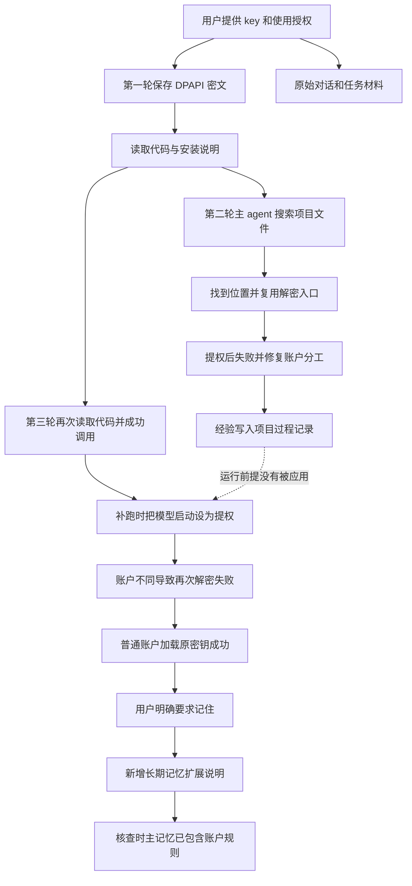

# GLM 凭据存储与跨对话记忆链路复盘

整理日期：2026-10-04。所有事件时间均转换为香港时间（UTC+8）。

本报告还原一次具体的跨对话信息使用事件：用户最初提供 GLM 与 DeepSeek 的 API key，助手将其加密保存在本机并完成实验；新对话一度询问凭据位置，随后自行找到；再一次对话已经能读取凭据，却在补跑实验时因换了 Windows 运行账户而解密失败。用户希望了解信息究竟保存在哪里、后续如何找到，以及为何一个解决过的问题会再次发生。

**核查结论：凭据文件和解密代码一直存在。第二次通过主 agent 搜索项目代码重新定位入口；第三次同样从代码取得入口，但没有遵守“普通账户加载模型凭据、提权代理执行 WSL”的运行前提。这个前提在第二次已经写入项目记录，却没有形成被可靠检索和执行的跨对话规则。直到用户明确要求记住，才新增了专门的长期记忆说明。**

本报告依据可读的会话消息、工具调用、项目文件和记忆文件，描述实际执行动作。没有复制任何密钥值、密钥密文或加密上下文摘要，也不以事后推测替代未知原因。

## 1 信息保存的五个位置

“保存了 key”与“后续对话知道如何使用 key”是两件不同的事。此次存在五类信息载体：

| 载体 | 此次保存了什么 | 后续如何使用 | 能证明什么 |
|---|---|---|---|
| 原始对话与任务材料 | 用户提供的模型、授权和 key 原文 | 需要取得该段历史或任务材料 | 原始信息曾被提供；不代表新对话已经取得全部历史 |
| 本机凭据文件 | `glm`、`deepseek` 两个字段的 DPAPI 密文 | 在适当 Windows 账户下解密 | 凭据已持久化；文件存在不代表任何账户都能使用 |
| 项目读取代码 | 文件路径、字段选择、解密函数和捕获输出方式 | 调用 `get_secret()` 或后续 `secret()` | 程序可以定位并读取凭据，不要求助手背出 key |
| 项目文档 | 安装位置、加密边界、故障及解决办法 | 主动搜索、阅读相关段落 | 操作经验已记录；不代表下次启动自动遵守 |
| Codex 长期记忆 | 项目摘要、检索线索，后来补入账户约束 | 在新对话中检索并应用 | 经验有跨对话入口；保存、读到和执行仍需分别确认 |

**当次上下文**是助手这一轮实际获得的信息集合。上述载体中的内容只有被提供、读取或检索后，才可能参与当前操作。一次运行成功也不代表其全部前提已经被提炼成长期记忆。

DPAPI 是 Windows 的数据保护机制。在此次配置中，密文的可用性与 Windows 运行账户有关。日志显示，普通 Codex 沙箱账户能解密，提权后使用的另一账户不能解密。因此，“路径正确、函数正确”仍不足以保证成功，账户身份也是操作前提。

## 2 第一轮如何落盘

### 2.1 凭据文件和读取函数

2026-10-02 00:44 左右的可见任务材料包含用户提供的两个 key。00:47:56，助手从当时的任务目标中取得值，并通过普通执行的 PowerShell 命令完成以下步骤：

1. 创建实验目录中的 `.private` 子目录。
2. 将两个 key 分别转为 SecureString，再使用 `ConvertFrom-SecureString` 得到当前用户 DPAPI 密文。
3. 写入 `D:\campus_re\experiments\memory_direction_20261002\.private\credentials.json`。
4. 建立项目的 `get_secret(provider)` 函数。

该函数从同一目录读 JSON，根据 `provider` 选择 `glm` 或 `deepseek`，用 `ConvertTo-SecureString` 解密，并将结果返回调用进程。输出由 Python 子进程捕获，调用方取得 key 后再访问模型服务。初版入口使用 `powershell.exe`；00:48:46 的代码修改将其调整为 `pwsh.exe`。

独立实验仓库保留了 [读取函数副本](D:/campus_re/cl-memory-exp/experiments/memory_direction_20261002/lab_common.py:10)。后续运行只需调用该入口，不需要再次从聊天中获取密钥。

### 2.2 项目文档保存了操作信息

[安装清单](D:/campus_re/cl-memory-exp/experiments/memory_direction_20261002/安装清单.md:20)记录了 `.private/credentials.json` 已写入、使用当前 Windows 用户 DPAPI、被 Git 忽略。[README](D:/campus_re/cl-memory-exp/experiments/memory_direction_20261002/README.md:47)也说明密钥配置仅适用于当前 Windows 用户。

因此，第一轮结束后，凭据值、可执行读取方法和人可阅读的安装说明都有持久化载体。原始输入也仍属于那次对话与任务记录。

### 2.3 没有发现专门的长期记忆写入

在第一轮可见工具调用中，没有发现将凭据位置、解密入口和运行账户约束专门写入 Codex 长期记忆目录的操作。

后来可见的该对话摘要记录了研究项目、模型、实验结论和目录线索，但没有完整记录上述凭据操作链。这说明项目知识有部分跨对话线索，不能说明凭据使用方法已经完整进入长期记忆。

这是对可见记录的判断，不是对所有后台缓存或摘要处理步骤的完整审计。

## 3 第二轮怎样重新找到位置

2026-10-02 的第二轮对话要求按研究方案运行实验，用户说明使用此前提供的两个 key。定位过程由主 agent 直接完成：

| 时间 | 主 agent 的可见动作 | 信息来源 |
|---|---|---|
| 18:38:21 和 18:38:27 | 阅读研究方案，搜索并读取 `MEMORY.md` 的片段 | 方案和长期记忆中的项目线索 |
| 18:38:35 | 询问 key 当前保存在什么文件或环境变量中 | 此时尚未完成本地入口定位 |
| 18:38:40 | 列出 `experiments` 目录，搜索 `getenv`、`base_url`、`deepseek`、`glm`、`credential` | 项目文件 |
| 18:38:53 | 继续搜索两个已有实验目录的 Python 文件 | 项目代码 |
| 18:39:03 | 直接读取 `memory_direction_20261002/lab_common.py` | 凭据读取函数 |
| 18:39:10 | 对 `.private/credentials.json` 执行 `Test-Path` | 本机文件存在性 |
| 18:39:18 | 回复已找到两个 key 的本地加密存储 | 上述查找结果 |
| 18:41:19 | 收到用户提醒：此前在其他项目提供过，可以查找 | 用户回复 |

**这次没有派子 agent 查 key，也没有读取第一次对话的原始会话日志来恢复位置。** 长期记忆提供了项目背景；确定位置的直接证据是项目代码，随后再检查实际文件存在。

时间顺序也修正了一个容易形成的印象：助手在收到用户提醒前已经找到了位置。问题是先问了用户、随后才完成自行查找；这次询问本可以通过先完成本地检索来避免。

## 4 第二轮已经解决过账户问题

同一天约 19:09，提权进程调用凭据读取函数失败。19:09:44 的工具调用明确采用了如下分工：

```text
普通执行的模型进程
  ├─ 加载原 DPAPI 凭据
  ├─ 调用模型
  └─ 通过受限回环接口请求执行任务代码

提权执行的 WSL broker
  ├─ 执行已限定的隔离沙箱入口
  └─ 不加载模型凭据
```

随后将故障和处理方式写入 [实验过程记录](D:/campus_re/cl-memory-exp/Agent_Memory_实验过程记录.md:84)：提权进程无法解密此前凭据，改为普通权限进程调用模型，由本机受限 broker 执行 WSL。

由此可以确认，第二轮已经完成了三件事：发现前提、修复执行结构、写入项目记录。缺少的是把该前提稳定地传递到后续启动操作。

### 4.1 为什么没有主动写入长期记忆

在这些历史对话的配置中，助手主动更新长期记忆受用户明确请求约束。用户当时要求执行实验、维护实验过程文档，没有明确要求将这次故障另存为长期记忆。第二轮工具记录也没有长期记忆写入调用。

这一点解释了为什么可见写入落在项目文档中。它不能证明助手曾作出“这个经验不重要”或“已有文档已经足够”的评估；操作日志没有支持这些具体判断。

另有该对话的摘要出现在记忆目录，但可见摘要没有提炼账户约束。摘要的完整生成流程和筛选依据不可由这些记录还原，不能断定它为何遗漏。

**没有长期记忆条目，并不妨碍读取已有项目记录。** 后续启动前仍应核对已经记录的运行前提，而不是仅复用函数名称和文件路径。

## 5 第三轮怎样知道位置又怎样再次失败

### 5.1 位置来自再次读取项目代码

2026-10-03 12:38:13，第三轮读取 `section7_observability_20261002/runtime.py`，并检查凭据相关入口。12:38:41，又搜索 `lab_common.py` 的 `get_secret()`。12:45:49 建立的审查脚本 `review.py` 包含原本机凭据路径和解密逻辑。

随后 GLM 审查在普通执行环境中成功运行。这说明第三轮并非从开始就不会解密：它已经通过现有代码取得并使用过原 key。

补跑 Jaccard 时，新 runner 复用 `engine.secret()`。路径已经在这段程序里，程序无需从长期记忆重新询问位置。因此，“第三轮主动知道位置”主要是已有代码提供了入口，不是已经确认长期记忆包含完整的凭据运行规则。

### 5.2 再次失败发生在账户改变之后

2026-10-04 01:01:55，助手把首题模型启动也设置为 `require_escalated`。随后原解密函数失败。诊断确认：

| 执行环境 | 实测 Windows 身份 | 读取同一份原 GLM 密文的结果 |
|---|---|---|
| 普通 Codex 执行 | `BAPP\codexsandboxonline`，SID 尾号 1007 | 成功 |
| 提权执行 | `BAPP\fucak`，SID 尾号 1003 | `ConvertTo-SecureString` 报 CryptographicException |

01:07 左右改回普通执行后，原密钥成功加载；01:08:00 向用户说明原因。没有替换凭据。

此次可以验证的直接链路是：

```text
凭据文件仍存在
  → 读取函数仍使用原路径与解密方式
  → 模型进程被改成提权启动
  → Windows 运行账户发生变化
  → 原 DPAPI 密文无法在该账户下解密
  → 改回普通账户
  → 同一份原密钥恢复可用
```

启动时没有应用第二轮已记录的账户前提，才是此次重复故障的可见断点。不能将它描述成密钥丢失、密钥失效或解密函数消失。

### 5.3 上下文压缩是否造成遗忘仍未知

第三轮在 2026-10-03 23:35:04 发生过上下文压缩。日志中的压缩内容为加密数据，不能检查具体保留或遗漏了哪些事实。

因此，不能确认账户前提是在压缩中被删掉，还是仍在上下文中但没有被使用。能够确认的是：后来的启动动作没有遵守它。

## 6 用户要求记住之后的更新

2026-10-04 01:14:43，用户明确要求把这次账户差异记住。01:15:31 发出写入调用，随后建立了专门的 [长期记忆扩展说明](C:/Users/fucak/.codex/memories/extensions/ad_hoc/notes/2026-10-04T000000-dpapi-glm-execution-account.md)。

该说明保存了凭据路径、实测账户差异、普通模型进程与提权 broker 的分工，以及解密失败先核对 `whoami /user` 的处理规则，没有保存 key 值。

助手当时新增的是扩展说明，没有直接改主 `MEMORY.md`。本报告核查时，主记忆中已经出现相同的账户规则，也可在第三轮的会话摘要中看到。但没有完整后台审计，不能精确说明每一步整合发生的时刻或筛选依据。

**当前可确认“说明已保存、主记忆已索引”；仍不能保证未来每次检索都会返回它，或每次执行都会遵守它。** “记下来以后就不会再错”超出了本次证据支持范围。

## 7 整条信息链与断点



图中实线表示已核实的保存、读取或执行关系。虚线表示后续没有应用已记录前提；它不代表已经查明是压缩、检索、注意分配或其他具体因素造成的。

| 环节 | 此次能够确认的状态 | 尚未闭合的部分 |
|---|---|---|
| 形成可用信息 | 密文、读取函数、账户限制已形成 | 没有缺失凭据本身 |
| 持久化 | 代码和项目记录已经保存 | 项目记录不会自动成为每次启动的检查项 |
| 跨对话提炼 | 早期摘要有项目线索；专门账户规则后来补入 | 无法完整审计早期摘要为何遗漏 |
| 检索 | 第二、三轮都找到了读取入口 | 第三轮没有可靠取得或应用全部运行前提 |
| 执行 | 普通账户成功，提权账户失败 | 已解决经验曾被后续错误启动方式违反 |
| 后续验证 | 新说明已进入可检索载体 | 尚无本报告范围内的未来独立对话检验 |

这件事可作为一次具体的信息持久化与复用失效案例：经验已经存在于项目中，但“保存、提炼、检索、执行”没有可靠衔接。它不能证明所有长期记忆都无效，也不能单独证明上下文压缩导致遗忘。

## 8 证据索引与可确认范围

以下索引用于本机复核。原始会话不复制进本报告，也不随报告导出；报告正文没有密钥值。

| 证据 | 会话或文件 | 关键记录 |
|---|---|---|
| E1 首次保存 | 会话 `01a0f79d-ff8c-76f2-bc4a-6f6f94f2b3fc` | JSONL 第 792 行，2026-10-02 00:47:56，普通执行保存 DPAPI 密文 |
| E2 读取入口调整 | 同上 | 第 785 行建立代码，第 808 行将 `powershell.exe` 改为 `pwsh.exe` |
| E3 第二轮询问与定位 | 会话 `01a0fc31-7170-7c61-94de-62e97058316f` | 第 28 行询问；第 33、41、51、58 行查找；第 66 行宣布找到；第 118 行收到用户提醒 |
| E4 第二轮账户修复 | 同上及项目过程记录 | 第 753 行提权解密诊断；第 761 行启动提权 broker 与普通模型进程；过程记录第 84 行记载处理 |
| E5 第三轮读取入口 | 会话 `01a1000d-2713-7c01-8827-c9e858f3c82f` | 第 40、48 行读取原代码；第 99 行建立审查脚本；第 222 行普通环境运行 GLM 审查 |
| E6 第三轮压缩 | 同上 | 第 853 行，2026-10-03 23:35:04；内容加密，未检查内部事实 |
| E7 第三轮错误启动与恢复 | 同上 | 第 1126 行提权启动模型；第 1195 行核对提权账户；第 1210 行确认普通账户恢复成功 |
| E8 明确请求与记忆写入 | 同上 | 第 1256 行用户要求记住；第 1262 行写入长期记忆扩展目录 |
| E9 修复后的项目证据 | [启动与审计恢复记录](D:/campus_re/cl-memory-exp/experiments/section7_frozen_jaccard_20261004/records/startup-and-audit-recovery.json) | 原凭据未替换，凭据失败未发模型请求，首题未重跑 |
| E10 当前长期记忆 | [扩展说明](C:/Users/fucak/.codex/memories/extensions/ad_hoc/notes/2026-10-04T000000-dpapi-glm-execution-account.md)及 `MEMORY.md` | 已包含账户分工和身份核验规则 |

原始会话分别位于 `C:\Users\fucak\.codex\sessions\2026\10\01`、`02`、`03` 下，以表中会话 ID 匹配对应 JSONL 文件。文件名中的时间不作为事件时间依据；本报告使用每条记录的 UTC timestamp 转换到香港时间。

**已证实：**保存位置、代码入口、主 agent 的搜索动作、提醒与查找的先后顺序、第二轮账户修复、第三轮错误启动、原密钥恢复、最后的专门记忆写入。

**无法确认：**助手当时是否曾评估该经验的长期价值；后台摘要为什么未保留完整操作前提；账户约束是否被压缩遗漏；未来对话是否必然检索并遵守新规则。

报告由侧对话核查已有记录后整理，不改变主线程实验状态或长期记忆。对于后续改进，本案支持把“存储位置、读取入口、运行前提、失败时的核验方法”作为同一项操作经验保存，并在实际启动时验证；是否因此避免再次出错，需要另行观察。
