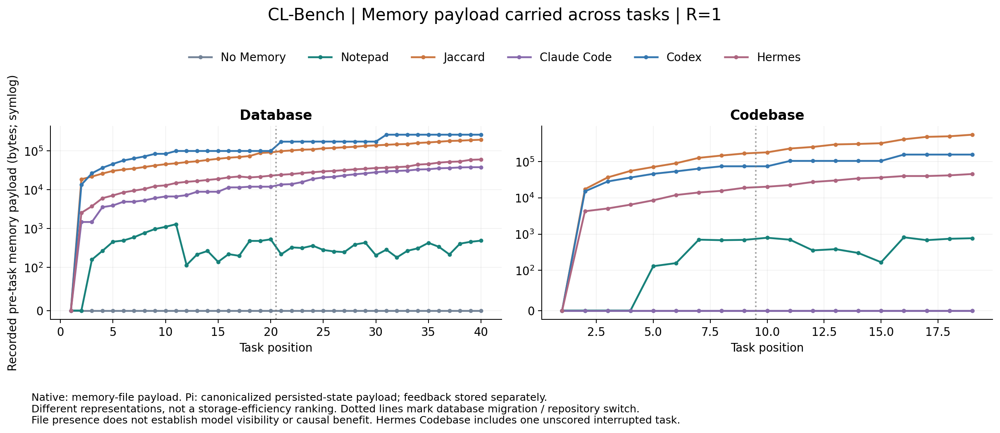

# CL-Bench：全量观测与记忆语义分析

更新：2026-10-05 20:42 HKT。状态：分析进行中，以下汇总随有效结果更新。

本实验让六套 agent 系统依次处理数据库或代码任务，每题使用新会话，允许读取各自前题形成的记忆。两种环境彼此隔离。本报告分析既有记录：记忆写了什么、被看到了什么、行为是否与之对应，以及相关成本。原业务评分保持不变，见[执行结果](RESULTS_FINAL.md)。

Pi No Memory 不向下一题提供前题记忆；Notepad 维护短笔记并独立携带上一题反馈；Jaccard 按词集合交并比选取最多三条历史 episode。Codex、Claude Code、Hermes 使用各自原生记忆流程，具体调度与恢复约束延续原报告。

共分析 354 个任务单元（353 已评分＋1 中止），拆为 426 个任务证据包和 84 个候选相关性包。当前通过验收 **509/510**，失败待处理 1，尚无当前有效结果 0；逆序复核有效 **26/26**。每个 unknown 都表示证据不足，不能换算为 0 分。

## 直接观察到的结果

- **Claude Code 的 Codebase 没有形成持久记忆文件。** 19 题均为 completed_noop；其 17/19 业务成绩不能作为“该流跨会话记忆带来提升”的证据。Database 则有 31 个 changed、9 个 noop，说明同一框架在两个环境的写入行为不同。

- **Codex 的主要可辨记忆成本来自整合。** 提取与整合均有原生记录；输出上限不等于实际生成量。实验取消原生等待并保留前期逐题、后期批次混合节奏，这些成本不代表日常默认 Codex。

- **Jaccard 会带入不同条件下的历史。** Codebase 51 次历史选择中 19 次来自另一仓库；Database 迁移后的 60 次选择中 37 次来自迁移前。它们是曝光组成，不自动等于错误或负迁移。

- **语义审查发现具体的边界问题。** 例如 Hermes Database 第 9 题前的技能把时间戳统一描述为毫秒，当前 g3 样本却是 TEXT 日期；本题随后更新了分组条件。Claude Database 第 1 题则从一次判错推导出广泛的时间戳处理规则，其隐藏评分机制并未被证实。这些是可复核案例，不是机制的因果排名。

## 指标覆盖与无法回答的部分

| 指标 | 计算方式 | 覆盖/边界 | 证据 |
| --- | --- | --- | --- |
| 官方评分、动作、reward、迁移前后/仓库分段、同题配对 | 代码 | 已完成，353 题有分数；1 题中止不补零 | [RESULTS_FINAL.md](RESULTS_FINAL.md) |
| 原实验全批次 attempts、缓存、未知 usage、旧题/恢复/中止成本 | 代码 | 已完成；按唯一 attempt，不将原生计数重复相加 | [records/final-closure-audit.json](records/final-closure-audit.json) |
| 角色用量归因 | 代码 | Codex 提取/整合可辨；其余原生请求部分只能按提交前后分组 | [records/full-mechanical-task-metrics.json](records/full-mechanical-task-metrics.json) |
| 会话隔离、任务交接、维护水位、持久化终态 | 代码 | 353 道已评分题验证；中止题独立处理 | [records/final-closure-audit.json](records/final-closure-audit.json) |
| 记忆体积、类型、变化、相同文件/段落 | 代码 | 已统计；Pi 是状态负载，原生是文件负载，不等于同口径磁盘占用 | [records/full-mechanical-task-metrics.json](records/full-mechanical-task-metrics.json) |
| 维护触发/NOOP/staged、作业、已知等待及恢复时长 | 代码 | 已提取最终原生状态；缺字段或缺原端到端时长仍为未知 | [records/full-lifecycle-metrics.json](records/full-lifecycle-metrics.json) |
| 子 agent/原生 job 数与父会话 | 代码 | 可取字段已统计；并非所有框架都有统一完整 actor 图 | [records/full-lifecycle-metrics.json](records/full-lifecycle-metrics.json) |
| 工具调用、精确重复、搜索/读写词法分类 | 代码 | 已统计；精确重复不等于无效操作，词法标签不等于实际执行效果 | [records/full-mechanical-task-metrics.json](records/full-mechanical-task-metrics.json) |
| 前题内容实际曝光 | 代码 | 长行精确匹配提供保守下界；不等于完整读取范围或真实依赖 | [records/full-mechanical-task-metrics.json](records/full-mechanical-task-metrics.json) |
| Jaccard 候选、排名、top-3、跨仓库/迁移选择 | 代码 | 59 次选择与原记录逐项复算；951 个候选-目标对 | [records/full-retrieval-details.json](records/full-retrieval-details.json) |
| 写入忠实性、相关性、适用条件、组织质量 | LLM judge | 按证据包评审，unknown 与 N/A 单列 | [records/full-semantic-task-labels.json](records/full-semantic-task-labels.json) |
| 可观察复用、重复操作合理性、误用/过时风险 | LLM judge | D1 解释；需要可定位原文，不宣称因果 | [records/full-semantic-task-labels.json](records/full-semantic-task-labels.json) |
| 候选相关性及 precision/recall/nDCG | LLM judge + 代码 | LLM 参考标签；仅完整且全部已知的候选集合进入指标 | [records/full-retrieval-details.json](records/full-retrieval-details.json) |
| 返回内容抽查、逆序证据复核一致性 | 人工式证据核对 + LLM | 当前助手抽查，不是独立人类金标；复核含提示澄清版本差异 | [records/judge-quality-spotcheck.json](records/judge-quality-spotcheck.json) |
| 压缩后是否保留关键约束 | 需前后上下文 + LLM | 没有捕获到可比压缩前后对；不能补造数值，也不能证明从未压缩 | [records/full-mechanical-summary.json](records/full-mechanical-summary.json) |
| 记忆造成提升/退化、子 agent 因果收益、批处理因果节省 | 需新干预实验 | 按用户选择未验证，不追加重跑 | [records/full-analysis-authorization.json](records/full-analysis-authorization.json) |
| Aixoras 实际账单金额、未知请求真实用量 | 服务端账单 | 账单/价目未取得；未知不填零，不套用旧 Z.AI 价格 | [records/full-analysis-summary.json](records/full-analysis-summary.json) |

## 记忆规模与维护行为

下表“变化题数”是快照内容变化，可能包括追加原始 episode、恢复或阶段性文件，不能直接当作 writer 作业次数。“曝光题数”只计长度至少 60 字符的前题记忆行在提交前实际模型请求中精确出现，是保守下界。Pi 的体积取规范化状态负载；原生体积取纳入记忆快照的文件负载。两者均非整个 home 的磁盘占用。

| 环境 | 方法 | 单元 | 内容变化题 | 长行曝光题 | 题前负载峰值 B | 末快照分类 |
| --- | --- | --- | --- | --- | --- | --- |
| Codebase | Claude Code | 19 | 0 | 0 | 0 |  |
| Codebase | Codex | 19 | 10 | 18 | 157,166 | notes: 49,388 B; extracted_sources: 138,390 B; skills: 10,309 B |
| Codebase | Hermes | 19 | 18 | 17 | 45,691 | notes: 658 B; bookkeeping: 18,841 B; pending: 9,995 B; skills: 21,291 B |
| Codebase | Pi Jaccard | 19 | 19 | 18 | 556,841 | episodic_store: 573,063 B |
| Codebase | Pi No Memory | 19 | 0 | 0 | 0 |  |
| Codebase | Pi Notepad | 19 | 16 | 15 | 815 | notes: 306 B |
| Database | Claude Code | 40 | 31 | 39 | 38,231 | notes: 38,531 B |
| Database | Codex | 40 | 13 | 39 | 263,444 | notes: 64,231 B; extracted_sources: 266,255 B; skills: 16,197 B |
| Database | Hermes | 40 | 40 | 39 | 60,604 | notes: 494 B; bookkeeping: 30,443 B; skills: 31,451 B |
| Database | Pi Jaccard | 40 | 40 | 39 | 195,434 | episodic_store: 201,037 B |
| Database | Pi No Memory | 40 | 0 | 0 | 0 |  |
| Database | Pi Notepad | 40 | 38 | 38 | 1,300 | notes: 470 B |



Notepad 的对错反馈是独立的 previous_feedback 字段，不含在 notepad 文本字节数中；其交接已单独核对。Jaccard 原始历史、Codex 提取源/摘要、Hermes skills 与 notes 的用途不同，不应凭总字节数断言谁更有效。相同段落可来自有意的多层索引，语义冗余必须另看。

曝光最初按提交前所有可取 provider 输入匹配；对原生系统仍需区分主会话与后台角色。Hermes 58 道已评分题的 1,790 条曝光长行中，1,724 条可由响应工具调用 ID 与主会话记录对应；剩余 66 条分布在 Codebase 第 11、19 题，角色未确认。两题的 judge 材料已把这些行从主求解者可见记忆中分离，只允许已确认子集用于当前任务的相关性/适用性/复用判断。中止题不在这项主会话佐证内。详见[角色核对](records/long-line-exposure-role-audit.json)。

| 环境 | 方法 | 最终屏障状态 | 已知维护秒数 | 维护时长未知题 |
| --- | --- | --- | --- | --- |
| Codebase | Claude Code | {'completed_noop': 19} | 199.5 | 0 |
| Database | Claude Code | {'completed_changed': 31, 'completed_noop': 9} | 1932.5 | 0 |
| Codebase | Codex | {'completed_changed': 10, 'completed_staged': 9} | 2634.8 | 4 |
| Database | Codex | {'completed_changed': 12, 'completed_staged': 28} | 4341.7 | 4 |
| Codebase | Hermes | {'completed_changed': 18} | 1854.3 | 2 |
| Database | Hermes | {'completed_changed': 40} | 2417.1 | 1 |
| Codebase | Pi Jaccard | {'not_applicable': 19} | 不适用 | 无独立异步维护 |
| Database | Pi Jaccard | {'not_applicable': 40} | 不适用 | 无独立异步维护 |
| Codebase | Pi No Memory | {'not_applicable': 19} | 不适用 | 无独立异步维护 |
| Database | Pi No Memory | {'not_applicable': 40} | 不适用 | 无独立异步维护 |
| Codebase | Pi Notepad | {'not_applicable': 19} | 不适用 | 无独立异步维护 |
| Database | Pi Notepad | {'not_applicable': 40} | 不适用 | 无独立异步维护 |

这些时间之和不是批次墙钟时间。恢复题缺失的原耗时保留未知，恢复片段另列。Claude 原生统计报告两种环境均 0 个 spawned 子 agent；Codex 59 题均有非空阶段一输出；Hermes 最终作业记录在 Codebase 为 25 个、Database 为 40 个，其中 Database 9 个旧作业没有完整 review_scope 字段。作业数、调用数、写文件次数是不同量，不能相加。

## 工具与可见存储的补充统计

| 环境 | 方法 | 精确重复业务动作 | 精确重复工具参数 | 末快照相同内容文件 / 重复段落 |
| --- | --- | --- | --- | --- |
| Codebase | Claude Code | 0 | 0 | 0 / 0 |
| Codebase | Codex | 0 | 1 | 0 / 0 |
| Codebase | Hermes | 2 | 21 | 0 / 0 |
| Codebase | Pi Jaccard | 0 | 0 | 0 / 0 |
| Codebase | Pi No Memory | 0 | 0 | 0 / 0 |
| Codebase | Pi Notepad | 0 | 0 | 0 / 0 |
| Database | Claude Code | 0 | 0 | 0 / 0 |
| Database | Codex | 0 | 0 | 0 / 0 |
| Database | Hermes | 0 | 30 | 0 / 0 |
| Database | Pi Jaccard | 0 | 0 | 0 / 0 |
| Database | Pi No Memory | 0 | 0 | 0 / 0 |
| Database | Pi Notepad | 0 | 0 | 0 / 0 |

业务重复只比较实际执行的 command 或 action/content，排除 thought 文案；工具重复比较名称与完整参数。它们都不判定是否浪费：相同测试可能是修改后的必要验证，同参数查询也可能针对已改变的状态。重复段落定义为去首尾空白后完全相同、至少 80 字符；分层摘要中的重复不自动视为坏组织。

| 环境 | 方法 | 末原生快照中的原始会话日志 B | 混合内容 SQLite/DB 文件 B | Git 内部文件 B |
| --- | --- | --- | --- | --- |
| Codebase | Claude Code | 7,028,114 | 0 | 0 |
| Codebase | Codex | 5,685,739 | 60,888,936 | 123,331 |
| Codebase | Hermes | 83,243 | 3,952,640 | 0 |
| Database | Claude Code | 8,953,091 | 0 | 0 |
| Database | Codex | 9,227,318 | 91,498,968 | 205,623 |
| Database | Hermes | 170,146 | 3,629,056 | 0 |

这三类只统计已捕获快照中相应文件的字节数，不是整个安装目录的物理磁盘占用，也不能把会话归档或 SQLite 文件当成全部已注入模型的记忆。

## 各角色的原实验用量

这里只展示能够可靠辨识的 Codex 提取与整合角色。其他角色详见逐题记录中的 cost_roles；原生提交前/后未归因项不能直接改名为 solver/writer。

| 环境 | 角色 | attempts | 已知 tokens | usage 未知 |
| --- | --- | --- | --- | --- |
| Codebase | unattributed_native_pre_submission | 253 | 6,561,711 | 0 |
| Codebase | codex_consolidation | 245 | 9,448,470 | 2 |
| Codebase | unattributed_native_post_submission | 53 | 1,132,219 | 0 |
| Codebase | codex_extraction | 20 | 534,335 | 0 |
| Database | codex_consolidation | 224 | 9,129,066 | 3 |
| Database | unattributed_native_pre_submission | 221 | 3,951,480 | 0 |
| Database | codex_extraction | 41 | 661,987 | 0 |
| Database | unattributed_native_post_submission | 100 | 1,716,923 | 0 |

原实验全部 5,642 个 attempts 的已知总量为 99,325,232 tokens，31 个 usage 未知，包含中止题、被替代旧题和验收成本。本报告新增 judge 成本另列，绝不混入原系统效率比较。

## 七项语义评审

评分标准为 0/1/2，另有 unknown 和 not_applicable。任务可能拆成多个包；下表只是该任务的已评片段中出现何种标签：任一 0 → I，否则任一 1 → M，否则出现 2 → P，随后为 U 或 N。P 不代表整题所有记忆都好，I/M 也不自动等于造成业务失败。长记忆被切包后，部分来源不在同包会增加 unknown，不能把各框架的标签直接当公平完整的标量排名。

表内顺序为 **P/M/I/U/N/未评**：出现 2 分、出现 1 分、出现 0 分、未知、不适用、无有效评审。各指标的 0 分含义不同；例如可观察复用的 0 仅表示未找到显式联系，不等于坏记忆或负迁移。

| 环境 | 方法 | 完整包覆盖任务 | 写入忠实性 | 曝光内容相关性 | 适用条件/时效 | 写入组织质量 | 可观察行为对应 | 重复操作合理性 | 压缩保留 |
| --- | --- | --- | --- | --- | --- | --- | --- | --- | --- |
| Codebase | Claude Code | 19/19 | 0/0/0/0/19/0 | 0/0/0/0/19/0 | 0/0/0/0/19/0 | 0/0/0/0/19/0 | 0/0/0/0/19/0 | 15/4/0/0/0/0 | 0/0/0/0/19/0 |
| Codebase | Codex | 19/19 | 9/1/0/0/9/0 | 16/2/0/0/1/0 | 13/5/0/0/1/0 | 7/3/0/0/9/0 | 11/7/0/0/1/0 | 7/10/2/0/0/0 | 0/0/0/0/19/0 |
| Codebase | Hermes | 19/19 | 9/9/0/0/1/0 | 15/2/0/0/2/0 | 10/7/0/0/2/0 | 12/6/0/0/1/0 | 15/2/0/0/2/0 | 6/9/3/1/0/0 | 0/0/0/0/19/0 |
| Codebase | Pi Jaccard | 19/19 | 0/0/0/0/19/0 | 2/15/1/0/1/0 | 11/6/1/0/1/0 | 0/0/0/0/19/0 | 0/16/1/0/2/0 | 15/4/0/0/0/0 | 0/0/0/0/19/0 |
| Codebase | Pi No Memory | 19/19 | 0/0/0/0/19/0 | 0/0/0/0/19/0 | 0/0/0/0/19/0 | 0/0/0/0/19/0 | 0/0/0/0/19/0 | 12/6/1/0/0/0 | 0/0/0/0/19/0 |
| Codebase | Pi Notepad | 19/19 | 12/4/0/0/3/0 | 3/12/3/0/1/0 | 11/4/1/1/2/0 | 12/4/0/0/3/0 | 3/9/3/0/4/0 | 14/4/1/0/0/0 | 0/0/0/0/19/0 |
| Database | Claude Code | 39/40 | 24/6/0/0/9/1 | 34/3/1/0/1/1 | 32/4/1/0/2/1 | 22/8/0/0/9/1 | 36/1/1/0/1/1 | 35/4/0/0/0/1 | 0/0/0/0/39/1 |
| Database | Codex | 40/40 | 7/4/0/4/25/0 | 39/0/0/0/1/0 | 33/6/0/0/1/0 | 8/5/0/2/25/0 | 36/3/0/0/1/0 | 25/14/1/0/0/0 | 0/0/0/0/40/0 |
| Database | Hermes | 40/40 | 28/11/1/0/0/0 | 39/0/0/0/1/0 | 36/3/0/0/1/0 | 26/13/1/0/0/0 | 35/4/0/0/1/0 | 24/16/0/0/0/0 | 0/0/0/0/40/0 |
| Database | Pi Jaccard | 40/40 | 0/0/0/0/40/0 | 19/20/0/0/1/0 | 30/9/0/0/1/0 | 0/0/0/0/40/0 | 12/27/0/0/1/0 | 37/3/0/0/0/0 | 0/0/0/0/40/0 |
| Database | Pi No Memory | 40/40 | 0/0/0/0/40/0 | 0/0/0/0/40/0 | 0/0/0/0/40/0 | 0/0/0/0/40/0 | 0/0/0/0/40/0 | 35/5/0/0/0/0 | 0/0/0/0/40/0 |
| Database | Pi Notepad | 40/40 | 28/9/1/0/2/0 | 18/18/3/0/1/0 | 33/5/0/1/1/0 | 29/9/0/0/2/0 | 22/14/3/0/1/0 | 34/6/0/0/0/0 | 0/0/0/0/40/0 |

“可观察行为对应”要求前题可见记忆与本题动作证据；相同命令也可能来自模型原有知识或本题提示，仍不证明心理依赖或因果贡献。所有压缩保留项不适用/未知仅反映缺少可比材料，不证明框架从未压缩。

## Jaccard 检索相关性

59 次原始 top-3 选择已逐项复算一致，候选共 951 对（Database 780、Codebase 171）。第 1 题没有历史，因此 57 道目标进入候选评审。相关性 1 表示背景/部分帮助，2 表示直接可迁移细节。检索选择对候选 judge 隐藏；这是同模型生成的参考标签，不是人类金标。

| 环境 | 参考阈值 | 完整标签目标 / 有候选目标 | 宏平均 precision | 宏平均 recall | recall 有定义目标 |
| --- | --- | --- | --- | --- | --- |
| Codebase | >= 1 | 18/18 | 57.4% | 42.7% | 18 |
| Codebase | >= 2 | 18/18 | 17.6% | 42.9% | 14 |
| Database | >= 1 | 39/39 | 60.7% | 26.6% | 39 |
| Database | >= 2 | 39/39 | 10.7% | 13.5% | 38 |

| 环境 | 已选择 / 全候选对 | 完整标签目标 | nDCG@k（相似度顺序） | nDCG 有定义目标 |
| --- | --- | --- | --- | --- |
| Codebase | 51/171 | 18 | 0.539 | 18 |
| Database | 114/780 | 39 | 0.323 | 39 |

precision = 选中且相关 / 选中数；recall = 选中且相关 / 全候选相关数。候选无相关项时 recall 无定义；有 unknown 时该题不进入这些均值。nDCG 用 2^score−1 增益、按 Jaccard 排名计算，实际输入按历史时间排序，两种顺序不能混为一谈。微平均、分母、每题标签与跨条件选择详见 [检索明细](records/full-retrieval-details.json)。

## Judge 返回质量与一致性

已核对 19 个有意选取的案例，覆盖六种方法、两类环境、候选检索和写入/使用判断。核对者是本聊天助手，不能称为独立人工金标或据此估计总体准确率。完整记录见[内容抽查](records/judge-quality-spotcheck.json)。

发现并处理的问题包括：空 JSON；字段/候选覆盖错误；引用不在原文；把当前新计划当作跨题记忆；把来源缺失当作差质量；解释中带未经证实的因果措辞。原响应和全部费用保留，不手改分数。引用校正仅允许可逆 JSON 显示变换、同源片段定位，或在所给材料中唯一命中的逐字原文定位；不把改写句变成证据。

Notepad 的输入证据曾遗漏独立反馈及写入时序，已对 59 个单元补全并作废旧包对应判断。引用当前记忆与动作的验收要求也已统一补查；不能因 HTTP 200 就认为内容合格。自由解释仍可能有过度措辞，报告仅采用经核对的有界事实，不原样传播因果断言。

内容验收仍有限制：例如 Hermes Codebase 第 11 题的重评仍把未提供终端返回的 EMPTY 断言评成混合支持。这是“缺少来源”与“确有不支持事实”之间的判据漂移，保留原 judge 标签并在抽查记录中标出；不能凭这个 1 分认定记忆虚构事实。格式/引用验证通过不等于每条语义结论已经被人类证明。

逆序复核覆盖 26/26 个有效包，共 202 个可比较条目。包含 N/A 的状态＋分数一致率为 86.1%；双方均可评分的 127 项分数一致率为 79.5%；至少一方可评分的 128 项状态＋分数一致率为 78.9%。

复核使用同一模型，并逆转证据文档顺序；实际执行跨越了格式/证据要求澄清版本及重试反馈，属于运行条件敏感性检查，不能当成控制变量完备的纯随机复测，更不是正确率。N/A 很多会抬高总体一致率，因此另报可评分子集。

执行与 judge 使用相同模型名，评审也未完全隐藏框架身份，因此可能存在共同模型偏差和身份提示偏差。候选检索选择已隐藏，不等于整个评审是双盲。接口请求中的 strict schema 仍需本地逐项验收；实际观察到服务端返回过违反所请求 schema 的内容，不能仅凭参数声明认定约束已执行。

## 新增分析成本与并发

Aixoras glm-5.3-flash 已记录 1,453 个实际请求，终态分布 {'finished': 1225, 'failed': 227, 'started': 1}；无 usage 的 228 个请求保留未知（包含仍在途者）。原始 usage 字段各自求和：输入 30,134,777，输出 8,964,607，provider total 39,116,258。有 286 次返回不满足 input+output=total，保留原值，不强行修平。实际金额未知，不套旧 Z.AI 价目。

75 并发试跑实际峰值为 75，没有观察到 429。该 25 包试跑共 40 次请求，35 次 HTTP 200、5 次 HTTP 524；终态耗时中位数 81.7 秒。包大小和组成不同，不能把此数与先前 50 并发批次直接解释为加速比，也不能当作服务商最大容量。按用户要求，5xx 留痕并重试，不作为自动降低并发的理由。后续目标总并发保持 75，实际在途量随尾批完成而下降。

关键原始证据的 2651 个文件哈希核对未变。新 key 只保存在忽略追踪的加密本地文件；请求、响应、完整轨迹和衍生证据包留在私有分析区，报告不回写被测 memory。

逐请求的无正文用量记录见 [新增 attempt 台账](records/analysis-attempt-ledger.json)，HTTP、耗时、重叠与原始 usage 核对见[调用审计](records/analysis-call-audit.json)。返回 model 字段作为接口身份记录，不能证明服务商未公开的内部实现。

## 复算与解释边界

所有指标的机器可读索引见 [覆盖清单](records/full-metric-coverage.json)。原始分数与因果范围不因 judge 判断而改变。跨框架比较仍受不同执行器、混合输出预算、Codex 混合整合节奏、R=1 和一个中止题限制。

[输入与结算收尾审计](records/full-analysis-closure-audit.json)逐包核对实际发送的请求、选用响应及当前证据哈希。[独立目录复算](records/analysis-reproduction.json)状态为 pass：510 个证据包重建后逐字节一致、冻结清单一致；复算未调用模型、未写原始实验文件。

离线复算（不会调用模型）：

```powershell
.local/clbench-venv/Scripts/python.exe -X utf8 summarize_full_analysis.py
.local/clbench-venv/Scripts/python.exe -X utf8 analyze_native_lifecycle.py
.local/clbench-venv/Scripts/python.exe -X utf8 analyze_retrieval_details.py
D:/anaconda3/python.exe plot_full_analysis.py
.local/clbench-venv/Scripts/python.exe -X utf8 write_full_analysis_report.py
```

full_analysis.py 可重新提取全部证据并自动补入 Notepad 时序；有 judge 请求在途时禁止重建。judge_full_analysis.py 是付费入口，本报告复算不需要运行它。
