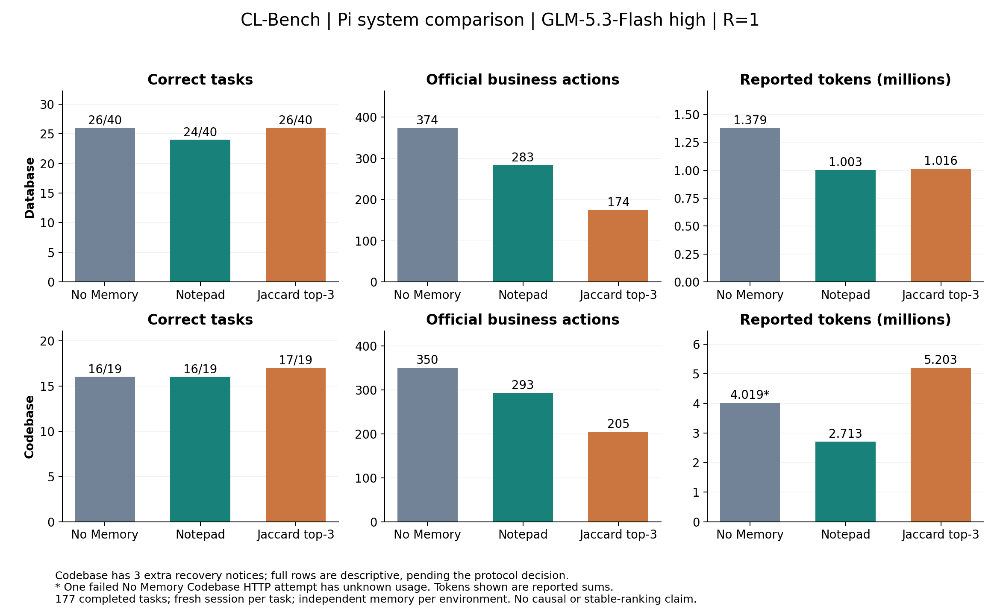

> 历史快照：三道授权重跑之前的结果。当前选用结果见 RESULTS_PARTIAL.md。

# CL-Bench 跨会话记忆实验：已完成流的阶段结果

后续配置修订：用户选择保留没有输出截断失败的旧题，后续调用统一使用 65,536 输出上限与 262,144 总窗口。下文已完成结果仍明确对应其实际旧预算，未被改写为“全程 64k”。核对 226 个已提交结果未发现输出截断；待处理的是 Hermes 正式流与 Codex 验收的未完成维护。原始准入证据见 [历史准入](records/compatibility-v1-16k.json)，新配置正在重新验收。

2026-10-05。这是本轮 **R=1 的阶段报告**，六条 Pi 流已全部完成，共 177 个任务；Claude Database 也已完成 40 题。完整流共 217 题，Hermes 另有 9 题完成业务与维护屏障；全矩阵仍未完成，不能据此排六组名次。当前无模型请求运行。执行状态见 [EXECUTION.md](EXECUTION.md)，带时间戳的统计见 [progress-summary.json](records/progress-summary.json)。

**扩展审计发现 Codebase 恢复偏差，结果接纳口径待用户决定。** No Memory 第 14、17 题及 Jaccard 第 19 题，在恢复后多收到一次“切换新仓库”提示。原始问题正文、base commit 与 grader 未变，但不能排除该提示影响当前行为及后续记忆。因此，下列 Codebase 全量数字保留为实际运行记录，暂不作为严格同提示比较。Database 没有这项偏差。已修复未来恢复逻辑，未改写或重跑既有结果；详情及共同未受影响前缀统计见 [protocol-deviations.json](records/protocol-deviations.json)。

这批结果支持一个具体判断：**记忆可以伴随更少的业务操作，但少操作不一定意味着少 token。** Database 的 Jaccard 与无记忆组同为 26/40，查询从 374 次降到 174 次；Codebase 的 Jaccard 从 16/19 提高到 17/19、步骤从 350 降到 205，但已知 token 从约 402 万增加到 520 万。Notepad 在 Codebase 上同为 16/19，使用 293 步、约 271 万 token。它们是这一次运行的系统表现，不是稳定排名或纯记忆因果效应。



## 1. 比较的条件

所有正式流使用同一账户的 Z.AI `glm-5.3-flash`，主求解 high；每题新建真实 Pi coding-agent 会话，同一题连续执行。三个方法使用同一底座、工具和 grader，只有许可的跨题信息不同：No Memory 不携带显式经验，Notepad 保留一份可整体替换的笔记，Jaccard 取本流既往合法 episode 的 top-3。官方业务状态仍然保留。

Database 40 题按官方顺序执行，第 21 题发生迁移；Codebase 为 tablib 9 题和 tenacity 10 题，每题恢复官方 base commit。Database 与 Codebase 的记忆、home、历史完全隔离；Codebase 从空记忆开始。根据用户选择，Codebase 求解时可见官方 test_patch，参考修复 patch 只在评分器侧；Database 正确答案不进入反馈或记忆。

总上下文固定 262,144；初始输出上限 16,384，真正耗尽时允许自动提高并调整输入预留。六条 Pi 正式流的最大已报告输入为 58,787 tokens，未发生压缩；因而本批结果不能用于判断长上下文压缩的优劣。长期记忆冷启动也不代表 provider 缓存清空。

Codebase v4 的两题验收前缀在配置未变化时延续为正式流，每题只计一次。旧 canary 和调试调用只计验收成本，不混入正式正确率。

## 2. 完整流结果

“动作”在 Database 为 QUERY 次数，在 Codebase 为官方步骤数，包含被官方计数的无效最终动作；两种环境的动作单位不相加比较。Reward 使用官方适配器输出，不另造综合分数。

**“正确”指官方判定，不等于精确数值或 SQL 语义完全一致。** 锁定版本对浮点答案接受 `abs(submitted − expected) <= max(question_tolerance, abs(expected) × 0.01)`，整数则要求精确相等。例如第 25 题，No Memory 与 Claude 采用不同价格列、给出不同数值，仍都被官方接受。机械审计另核对各方法收到相同问题且私有正确答案一致；没有把这些隐藏值或可枚举的答案哈希导出。

| 环境 | 方法 | 正确 / 任务 | 动作 | 平均 reward | 已知总 token | 用量未知的请求 |
|---|---|---:|---:|---:|---:|---:|
| Database | No Memory | 26/40 | 374 | 0.26834 | 1,379,200 | 0 |
| Database | Notepad | 24/40 | 283 | 0.36833 | 1,003,361 | 0 |
| Database | Jaccard | 26/40 | 174 | 0.46834 | 1,015,966 | 0 |
| Database | Claude Code | 32/40 | 187 | 0.55833 | 8,838,994 | 0 |
| Codebase | No Memory | 16/19 | 350 | 0.49605 | 4,018,562 | 1 |
| Codebase | Notepad | 16/19 | 293 | 0.59474 | 2,712,959 | 0 |
| Codebase | Jaccard | 17/19 | 205 | 0.67763 | 5,202,593 | 0 |

Codebase No Memory 的一次 HTTP 500 没有 usage，因此 4,018,562 是已知部分，不是精确总成本。与它计算 token 增幅只能称“已知和的差”，不能给未知请求偷偷填零。完整逐题和 attempt 索引见 [task-index.json](records/task-index.json)。

| 阶段 | No Memory：正确 / 动作 | Notepad：正确 / 动作 | Jaccard：正确 / 动作 |
|---|---:|---:|---:|
| Database 迁移前，20 题 | 18 / 184 | 14 / 127 | 15 / 80 |
| Database 迁移后，20 题 | 8 / 190 | 10 / 156 | 11 / 94 |
| tablib，9 题 | 7 / 182 | 9 / 125 | 9 / 88 |
| tenacity，10 题 | 9 / 168 | 7 / 168 | 8 / 117 |

迁移前后不是同一组问题，不能把后半段成绩变化直接解释为学会或遗忘。Codebase Notepad 总正确数不变，也掩盖了仓库间差异：它在 tablib 多答对两题，在 tenacity 少答对两题。

Claude Database 迁移前 17/20、108 次 QUERY，迁移后 15/20、79 次 QUERY。相对 Pi No Memory，它多答对 6 题，查询数减半，但总 token 约为 6.41 倍。这是包含原生提示、工具组织、记忆与维护的系统差异，不能把 6 题提升单独归因于记忆。其独立原生 stateless 对照不在本轮范围。

## 3. 同题、双方都正确的效率

以下每行都与 No Memory 配对，差值为“记忆方法减无记忆”。先列相同成功结果下的动作差，再列 token。该子集按观察到的结果筛选，不能替代全量结果，也不是反事实实验。

| 环境 / 方法 | 双方正确题数 | 动作差 | 已知 token 差 | 去除任一方用量缺失的题后 |
|---|---:|---:|---:|---|
| Database / Notepad | 20 | −46 | −142,980 | 20 题，差值相同 |
| Database / Jaccard | 21 | −93 | −88,787 | 21 题，差值相同 |
| Database / Claude Code | 24 | −94 | +4,127,974 | 24 题，用量完整 |
| Codebase / Notepad | 14 | −59 | −999,797 | 13 题，−599,811 tokens |
| Codebase / Jaccard | 14 | −84 | +1,367,374 | 13 题，+1,360,198 tokens |

正确率的交换也要看：Database Jaccard 相对 No Memory 有 5 题由错变对、另有 5 题由对变错；Notepad 是 4 题由错变对、6 题由对变错。Codebase Jaccard 为 3 题由错变对、2 题由对变错，Notepad 为 2 题对换。一次运行不足以断言不存在负迁移。

Claude Database 相对 No Memory 有 8 题由错变对、2 题由对变错；双方都正确的 24 题中，它少 94 次 QUERY，但多约 413 万 token。其全部 370 个实际请求均有用量，原生角色标签合并了求解和维护，不能精确拆出记忆 writer 单独的 token 成本。

恢复偏差的诊断表如下，是否接纳仍待用户决定，不用子集替换完整 benchmark 成绩。最保守的共同前 13 题不包含多余提示；另列逐字提示相同的全部 16 题。两个 No Memory 偏差任务不携带跨题记忆，Jaccard 的偏差发生在最后一题，所以其余题未通过这两条显式记忆通道收到该提示；这仍不是受影响题目的反事实证明。

| 诊断范围 | No Memory：正确 / 动作 / 已知 tokens | Notepad：正确 / 动作 / tokens | Jaccard：正确 / 动作 / tokens |
|---|---|---|---|
| 共同前 13 题 | 10/13 · 236 · 2,433,625 | 11/13 · 200 · 1,544,533 | 13/13 · 123 · 2,587,219 |
| 全部同提示 16 题 | 13/16 · 315 · 3,822,782* | 13/16 · 265 · 2,514,843 | 15/16 · 192 · 4,935,055 |

星号仍代表包含一条 usage unknown 的失败请求。

Codebase Jaccard 的已知输入 token 为 5,084,925，而 No Memory 为 3,885,458；输出反而较少，117,668 对 133,104。增加量主要在输入侧。Jaccard 每题实际注入的完整 episode 最大合计 58,846 UTF-8 bytes；Notepad 的任务开始笔记最大为 815 bytes。这里的 bytes 只是载荷大小，不能当 tokenizer 数值或相关性真值。

## 4. 少量轨迹复核

本次挑选 6 个独立目标检查关键动作、当时可见记忆及反馈，并另外定位 2 个恢复事件目标；合计 8 个，保留首次最多 12 个目标的上限。没有新增模型调用，没有把复核结果写回被测记忆。证据文件路径、哈希与 D0/D1/unknown 划分见 [semantic-review.json](records/semantic-review.json)。

- **Database 第 5 题（instance 4）：** 三组均答对，分别 15、7、2 次 QUERY。无记忆组检查了多种关联键和统计表；Jaccard 先检验键的覆盖，再直接聚合。既往 episode 确实在输入中，但没有移除记忆的同起点分叉，不能把全部 13 次查询差都认定为记忆作用。
- **Database 第 21 题（instance 114）：** 三组在明确迁移提示后均答错。Jaccard 已查看新 schema 和价格列样本，仍使用覆盖不完整的美元字段计算。少查询不保证处理好字段语义变化；这也不是“没有看到迁移通知”。
- **Database 第 25 题（instance 101）：** No Memory 14 次 QUERY 后答对，Notepad/Jaccard 用 8/2 次但答错。无记忆轨迹发现两种价格字段的非空覆盖不同，进一步检查了缺失价格段；两种记忆方法采用了美元列。可确认具体行为差异，尚不能证明由旧记忆导致。
- **tablib-596：** No Memory 38 步失败，Notepad/Jaccard 16/12 步成功。无记忆组曾出现本地测试通过、独立评分失败；测试数量和模型自称完成都不能代替官方评分。两个记忆方法仍有额外探索或失败动作，不是直接照抄一个已知正确补丁。
- **tenacity-610：** Jaccard 29 步成功，但消耗 1,261,799 tokens，是该组 Codebase 最高成本题。其 top-3 含一条 tablib 历史，在本环境流内合法但跨项目；另有多次实现、测试与调试。增加输入成本与这些事实一致，不能仅凭检索命中断言来源有效或无效。
- **tenacity-615：** Jaccard 的本地测试显示通过，但它把测试和提交 echo 合成一个命令，随后只给文字总结；官方要求提交命令单独执行，因此没有形成合法提交。按官方无效响应入口记零分，不把“我已完成”的文本转成命令。这里的失败包含协议可靠性，不能简化成修复算法能力。

## 5. 成本、时间与异常边界

逐唯一实际 HTTP attempt 计数，缓存属于输入、reasoning 属于输出，不重复相加。Pi 的目录零费率和原生 CLI 的美元估算均不用作 GLM 账单。全部正式、验收、失败和未完成请求保留在 [attempt-ledger.json](records/attempt-ledger.json)；正在进行的请求没有最终 usage 时只标未知。

可以按已核对的 [Z.AI 官方价格](https://docs.z.ai/guides/overview/pricing) 计算公开 token 价目等价值；结果不代表账户实际扣费，也不是实际支出的下界，套餐和折扣未经核验。六条 Pi 流的已知等价值约为：Database No Memory $0.121572、Notepad $0.081579、Jaccard $0.061482；Codebase 分别 $0.218653、$0.158408、$0.273236。No Memory Codebase 仍有一条未定价失败请求。

Claude Database 的已知 token 价目等价值为 $0.548802。其 40 题记录的持续时间累计 8,905.423 秒，提交后至原生完成及快照的等待累计 1,932.471 秒；后者包含最终整理、存储和控制器工作，不能全称“记忆计算时间”。原生压缩事件数与完整 memory store 字节量尚未从归档统一提取，汇总标 unknown，不填零。

截至当前停点，正式类别共 2,434 个实际请求、25,668,501 个已知 tokens，另有 2 条 usage unknown；这包含 Hermes 未完成维护的请求。验收/调试为 562 个请求、6,711,395 个已知 tokens，另有 8 条 usage unknown。对应已知公开价目等价值合计 $2.034308；未知用量仍未定价，也没有核对账户实际扣费。

任务时间是本轮并发环境下观察到的持续时间，不与历史串行运行计算加速比。No Memory Codebase 有 2 题、Jaccard 有 1 题无法精确重建整题时长；完整时间配对子集单列在 [efficiency-analysis.json](records/efficiency-analysis.json)，不把部分时间和当作总耗时。Pi 笔记写入与求解共享调用，没有可独立分离的异步维护秒数；unknown 不补为零。

两次 Codebase 无效最终响应通过锁定版官方 parser 复核后按官方 system-error 规则计零分，没有再次求解。HTTP 500 则保留原会话，并在首次重发时断言 payload 与失败请求完全相同；只读沙箱校验另计为控制器恢复工作。详见 [执行记录](EXECUTION.md)。早期误启用 60 秒超时、高参数漏映射、旧容器故障和 Codex 屏障错误均属于被排除的验收批次，费用保留，结果不混入主表。

## 6. 尚未回答的问题

Claude Database 已完成且通过当前机械核验。Hermes 已完成 9 个业务与维护屏障，第 10 题业务已答对但维护超过 600 秒，暂不推进下一题。Codex 已验证实际提取、整合及新题接收摘要的路径，但验收中第二题整合耗尽输出预算；原生 Codebase 尚未放行。最终 JSON 处理、Codex 原生 90% 压缩阈值、随输出预算延长维护等待，以及已发现的 Codebase 提示偏差接纳口径，共 4 项待用户决定，记录于 [EXECUTION.md](EXECUTION.md)。本报告不比较未完成前缀与完整流。

当前值得继续确认的是：在原生系统全部完成后，它们是否能改善迁移后的字段选择，同时让维护开销落在可接受范围；Jaccard 的命令减少是否值得更多输入曝光。当前证据还不支持增加新机制、重跑 R=2 或扩大优化轮次；这些不属于已授权的本轮执行。

## 7. 复现与审计

运行锁见 [runtime-lock.json](records/runtime-lock.json)，准入证据见 [compatibility.json](records/compatibility.json)。对已提交任务，机械审计检查官方顺序与评分、跨题新会话、前后记忆交接、Jaccard 仅取过去来源、合法反馈、冻结提交哈希、实际模型/high 参数及上下文预留。隐藏答案和原始请求不进入公开报告。

在本目录执行以下离线命令即可更新统计；它们不发起模型调用、不更改运行分支：

```powershell
& ./.local/clbench-venv/Scripts/python.exe summarize_results.py
& ./.local/clbench-venv/Scripts/python.exe audit_results.py
& ./.local/clbench-venv/Scripts/python.exe analyze_results.py
& D:/anaconda3/python.exe plot_results.py
```

JSON 是统计依据，本阶段正文对应已冻结的七条完整流。机械审计对已知三处 Codebase 提示偏差继续返回失败；修复测试通过不意味着历史偏差被消除。接下来需先收到四项口径答复，再恢复相关验收与流，不静默把当前部分结果称为最终结论。
