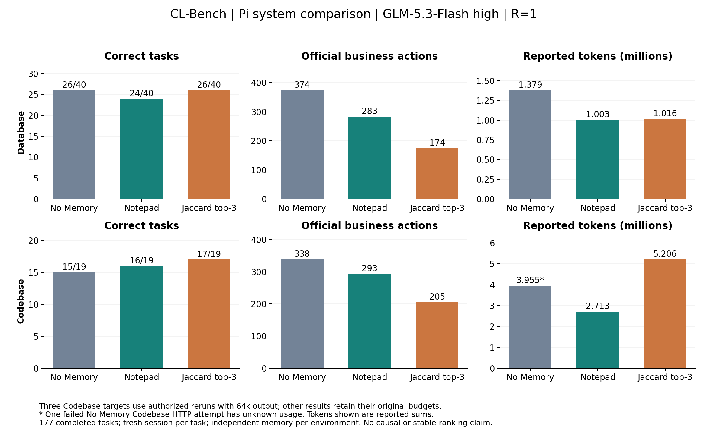

# CL-Bench 阶段结果：已纳入三题授权重跑

2026-10-05。六条 Pi 流和 Claude Database 已完整执行；Hermes Database 有 9 题完成业务与记忆屏障，第 10 题业务已固定、维护未完成。全矩阵尚未完成。用户要求重跑的三道 Codebase 题已各重跑一次，当前比较采用全部三次新结果，包括一次由通过变成未通过的结果。

原始 run、旧评分和费用均保留。重跑前报告见 [历史快照](RESULTS_BEFORE_TARGETED_RERUNS.md)，本次原因排查与逐题结果见 [维护诊断和重跑报告](MAINTENANCE_DIAGNOSIS_AND_RERUNS.md)。

## 当前选用结果

所有流使用同一账户的 GLM-5.3-Flash、主求解 high，Database/Codebase 的记忆完全隔离。三道重跑使用共同的 65,536 输出上限；其余已完成任务保留真实旧预算，没有被改写为“全程 64k”。总窗口保持 262,144，后续输入压缩触发为 196,608。按用户决定，未受输出截断影响的旧题不整批重跑。

| 环境 | 方法 | 正确 / 任务 | 官方动作 | 已知总 tokens |
|---|---|---:|---:|---:|
| Database | Pi No Memory | 26/40 | 374 | 1,379,200 |
| Database | Pi Notepad | 24/40 | 283 | 1,003,361 |
| Database | Pi Jaccard | 26/40 | 174 | 1,015,966 |
| Database | Claude Code | 32/40 | 187 | 8,838,994 |
| Codebase | Pi No Memory | **15/19** | **338** | **3,954,899** |
| Codebase | Pi Notepad | 16/19 | 293 | 2,712,959 |
| Codebase | Pi Jaccard | 17/19 | 205 | 5,205,805 |

Database 的动作是 QUERY 次数；Codebase 的动作是官方步骤数。No Memory Codebase 保留的一次 HTTP 500 没有 usage，上表该组 token 是已知部分。其他完整流的选用结果用量完整。未完成的 Hermes 前缀不与完整流直接排名。



“正确”使用原生 grader：浮点答案接受 `abs(submitted − expected) <= max(question_tolerance, abs(expected) × 0.01)`，因此通过不证明数值或 SQL 语义完全一致。Codebase 使用独立评分器恢复官方测试，模型本地测试通过不能替代官方评分。隐藏答案和参考修复不进入 agent 记忆；test_patch 按用户要求可见。

## 配对效率

差值均为对应方法减 Pi No Memory；先看双方都被官方判对的同题，避免把提前答错造成的少操作混成效率收益。该子集按观察结果筛选，仍不是反事实实验。

| 环境 / 方法 | 双方正确题数 | 官方动作差 | 已知 token 差 |
|---|---:|---:|---:|
| Database / Notepad | 20 | −46 | −142,980 |
| Database / Jaccard | 21 | −93 | −88,787 |
| Database / Claude Code | 24 | −94 | +4,127,974 |
| Codebase / Notepad | 13 | −60 | −1,048,641 |
| Codebase / Jaccard | 14 | −83 | +1,362,465 |

Codebase 配对中去除用量缺失的任务后，Notepad 的 12 题少 648,655 tokens，Jaccard 的 13 题多 1,355,289 tokens。全部差值、正确性互换及来源索引见 [修正后的统计](records/corrected-efficiency-analysis.json) 和 [修正后的逐题索引](records/corrected-task-index.json)。

这次结果表现出明确取舍：Jaccard 的业务动作更少，Codebase 输入开销却更大；Claude Database 多答对 6 题、QUERY 减半，但总 token 约为 No Memory 的 6.41 倍。原生提示、工具组织、辅助调用和记忆都不同，这些差异不能全部归因于 memory。R=1 与三次指定纠正也不支持稳定排名、统计非劣或纯提示效应结论。

## 三题如何纠正

No Memory 第 14、17 题以及 Jaccard 第 19 题的恢复流程曾多发“切换到新仓库”提示。修复后从各题原有的 memory-before 和官方 base commit 重跑：分别得到通过/9 步、未通过/5 步、通过/4 步。第 17 题原来通过，当前照实采用新失败结果，不挑高分。

每次都验证新 session、题前记忆一致、没有当前题旧答案/反馈、实际 high 和 65,536 cap、官方评分及完整屏障。Jaccard 从原题前历史按修正后的提示重新检索。No Memory 不携带跨题经验；Jaccard 修正的是最后一题，故无需重跑后续记忆链。选择清单见 [code-result-selection.json](records/code-result-selection.json)。原始机械审计仍记录历史三处偏差，重跑不会抹掉旧错误。

## 维护耗时诊断

Hermes 先前 9 题维护等待中位数 32.765 秒，最长 141.374 秒。第 10 题的 600 秒超时由以下顺序构成：约 46 秒主会话收尾、127 秒技能读取响应、196 秒后发生服务端错误、213 秒生成重复补丁直到 16k 截断。随后更大的输出预算请求只产出 1,906 tokens，但开始时只剩 16.47 秒，最终响应在截止之后才完整到达。

异常工具参数中，同一段 990 字符的补丁被重复 54 次。实际镜像源码确认：该版本的重复检测遇到工具调用会跳过，未覆盖重复的工具参数。并发门等待均为零。1.3 秒的辅助调用是在生成会话标题，不是记忆 writer。没有首 token/逐 chunk 到达日志，不能精确分离远端排队、生成和传输。

因此，不能从这次异常直接推断“正常整理记忆需要 40 分钟”，也不能保证扩大输出上限会消除循环。诊断没有改变原生 writer、重试策略或 600 秒等待值；细节和证据见 [专门报告](MAINTENANCE_DIAGNOSIS_AND_RERUNS.md)。

## 成本与证据边界

按唯一实际 HTTP attempt 记账，缓存不重复加入 input，reasoning 不重复加入 output。三次重跑新增 **23 请求、162,573 tokens**；原始被替代尝试费用仍保留。已知公开 GLM token 价目等价值约 $0.012730，不能当账户实际扣费。全批次及未知项见 [attempt-ledger.json](records/attempt-ledger.json)、[progress-summary.json](records/progress-summary.json)。选用结果的 token 合计不同于整个研究批次的开销。

No Memory Codebase 有两题原始整题耗时无法精确恢复，Jaccard 有一题；它们不填零。并发运行的任务耗时不与历史串行运行计算加速比。原生角色记录合并了求解与维护，不能把全部额外 tokens 或提交后等待都归为记忆 writer。原生压缩事件与完整存储量未统一提取的部分仍标 unknown。

框架版本、原生 writer 策略和反馈规则未因本次诊断改变。Database 问题正文与隐藏评分答案跨方法一致，隐藏值不导出。新的 64k 规则已在这三次 Pi 重跑的实际请求上验证；原生新配置还需验收。其他原生流的后续执行状态见 [EXECUTION.md](EXECUTION.md)。

## 离线复现

```powershell
& ./.local/clbench-venv/Scripts/python.exe diagnose_hermes_maintenance.py
& ./.local/clbench-venv/Scripts/python.exe summarize_results.py
& ./.local/clbench-venv/Scripts/python.exe analyze_results.py --corrected
& D:/anaconda3/python.exe plot_results.py --corrected
```

以上命令不调用模型、不回写被测记忆。`rerun_code_target.py` 是付费执行入口，只允许已授权的三个目标，已经完成，不应为提高分数重复调用。
