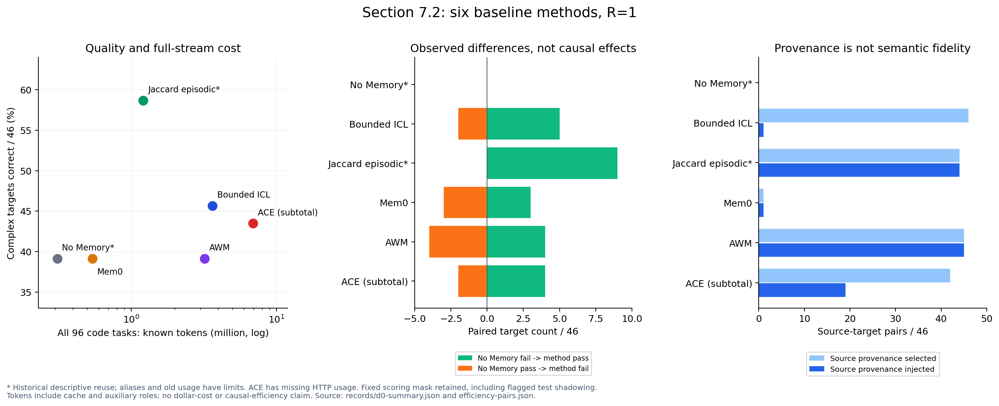

# 第 7.2 节：baseline 数据分析与 LLM 辅助审查

日期：2026-10-03（香港时间）。状态：授权的离线分析与 324 条辅助审查已完成；关键证据由主 agent 复核，未冒称人工真值。第 7.3 及之后的受控干预、方法开发、重复和未见验证均未执行。

## 1. 当前最重要的判断

1. **Jaccard 在本次记录中的正确数最高，但付出了更多输入成本。** 复杂目标 27/46、全代码 71/93；完整代码流 1,214,123 tokens，是 No Memory 310,663 的约 3.91 倍。有效复杂目标工作工具数同为 52，不能称为全面效率提升。9 个改善、0 个损害是 R=1 的描述性配对结果；其中 `new:BigCodeBench/954` 的无记忆侧遭遇工具传输失败，不能解释为纯记忆能力收益。
2. **不同方法的实际瓶颈不能合并成“检索不好”。** ICL 的 46 个源都在包装前选择集中，但 45 个被字节预算淘汰；Mem0 大部分没有形成对应源内容；AWM 从任务索引 47 起 workflow 不再更新；ACE 的来源条目会部分被预算淘汰，且辅助调用与大上下文费用高。这些是 D0 机制运行事实，不是算法本质优劣。
3. **16 条“源通过且已注入仍失败”不能直接作为 USE_TRANSFER 失败率。** 已逐条复核，主要混有目标新增条件、未说明的接口细节、题意/测试张力。`559` 的固定列名迁移是较具体的适配候选；其他案例不能因失败就认定记忆造成损害。
4. **发现了一项确定的评分结构问题。** `new:BigCodeBench/316` 的测试重新定义被测函数，覆盖提交实现；六方法原记录均成功。96 个任务的静态同名定义扫描只有该题命中。保留原评分和固定 mask，仅单列 D0 风险；没有擅自重评分或删题。
5. **DeepSeek 可用作审查助手，原始自动标签不够可靠，不能直接统计成机制失败率。** 同一小样本与 GPT 参照的语义一致性较高，但全量抽核仍发现标签含义、D0/D1 和环境协议错误。报告结论依靠 D0 重算及可追溯案例复核，原始 D1 标签单独保留。



## 2. 范围与证据等级

- D0：六方法 624 次正式矩阵执行，包括 576 次代码执行、48 次 BabyAI。每方法代码执行 96 题、固定评分 93 题；复杂目标执行 48、评分 46。18 条代码记录仍为原资产不可评分，费用不删除。全矩阵原记录为 404 成功、202 可评分失败、18 不可评分；基础设施诊断另列，不改原分数。
- D1：46 个有效复杂目标 × 6 方法 + 8 个 BabyAI × 6 方法 = **324 条**，成功与失败均覆盖；普通源题按同方法自己的历史回溯。
- D2：**0**。无新的 agent rollout、第二遍、独立重复、因果分叉或外部验证。离线审查不回写 writer、retriever 或 memory。
- No Memory/Jaccard 是历史描述性复用；模型别名、并发与历史 usage 可核验程度不同，不做统一速度/因果优势比较。金额无核验账单，保持未知。

[冻结协议](PROTOCOL.md)、[324 条清单及预登记抽核](records/manifest.json)、[原始输入哈希](records/source-hashes.json)。

## 3. 审查模型校准与选择

按用户要求，先冻结同一提示词和 6 个证据包：Jaccard 失败/成功各一，另有 ICL、Mem0、AWM、ACE，共 4 个失败与 2 个成功。GPT 6.1 sol xhigh 子 agent 只看这六份相同材料，输出 operational golden reference；不是人类真值，也不是重新评分器。

首轮 10,000 输出上限导致 DeepSeek 3/6、GLM 6/6 没有完整 JSON。用户批准第二轮 24,000 上限；GLM 拒绝 medium 参数，六次请求保留为配置错误。用户另批准 GLM high 六条，先单条验收再跑余下五条。DeepSeek 请求 medium 在官方映射中实际为 high。不同模型的同名 effort 不代表相等计算量。

| 有效校准配置 | 原样可解析 JSON | 严格原始引用/schema 通过 | 四语义字段与 GPT 一致 | 多标签 micro F1 | 已知 tokens | 请求时长合计 |
|---|---:|---:|---:|---:|---:|---:|
| DeepSeek，24k，medium→high | 6/6 | 4/6 | 20/24 = 83.3% | 0.615 | 189,466 | 264.7 秒 |
| GLM，24k，high | 5/6 | 1/6 | 14/24；仅已解析为 14/20 | 0.556 | 149,167 | 411.2 秒 |
| GLM，仅本地补一个缺失括号后 | 6/6（派生修复） | 原校验结果保留 | 18/24 = 75.0% | 0.600 | 无新增调用 | 无新增调用 |

选 DeepSeek：完整输出、可定位引用、参照一致性更好，代价是更多 tokens。六条不能证明总体排名或稳定性；语法修复后的标签 F1 差距很小。主标签也常分歧，不能将最高相似度当真值。两者都在成功计数案例和 AWM 通用流程案例中过度判断“已使用”；Mem0 空写入这一点 GLM 标签反而更精确。

[提示词](review_prompt.txt)、[原比较表](records/pilot-comparison.json)、[语法修复敏感性](records/pilot-syntax-sensitivity.json)、[六条分歧裁决](records/pilot-adjudication.json)、[模型冻结](records/model-selection.json)。

正式审查复用 DeepSeek 第二轮 6 条，再请求 318 条。末尾 14 条因 HTTP 402 余额不足失败；用户充值并明确继续后，只对这 14 条按原配置重发，先单条确认恢复。原 402 与新结果均保留。没有改用别的标注器混入正式集合。

## 4. 正确性与效率必须一起看

| 方法 | 复杂目标 /46 | 全代码 /93 | BabyAI /8 | 全代码已知 tokens（96 题） | 代码工作工具 / SUBMIT | 相对无记忆改善 / 损害候选 |
| --- | --- | --- | --- | --- | --- | --- |
| No Memory | 18 | 60 | 3 | 310,663 | 105 / 101 | 0 / 0 |
| 受限 ICL | 21 | 63 | 5 | 3,637,459 | 152 / 96 | 5 / 2 |
| Jaccard episodic | 27 | 71 | 6 | 1,214,123 | 110 / 96 | 9 / 0 |
| Mem0 | 18 | 61 | 4 | 542,447 | 119 / 96 | 3 / 3 |
| AWM | 18 | 59 | 4 | 3,211,143 | 147 / 96 | 4 / 4 |
| ACE | 20 | 63 | 5 | 6,916,335 + 未知 | 186 / 95 | 4 / 2 |


“改善/损害”是相同目标上相对 No Memory 的成败差，方法各自拥有自己的历史；**不是相同历史快照下只切换 memory 的反事实**。未做第二次重复，0 个损害不证明不存在负迁移。

No Memory 的 `new:BigCodeBench/954` 可见 2 次 PYTHON、6 次 SUBMIT 均为 `fetch failed`，没有真实提交。这被归入基础设施中断的诊断视图，原评分仍为失败。其缺失工件被隐藏测试调用后得到 NameError，不能据此诊断模型解题能力。代码中相同工作参数额外次数为 0；这个狭窄字符串代理不能证明没有语义重复探索。

### 4.1 目标与完整流成本分开

| 方法 | 46 个有效目标已知 tokens | 48 个执行目标已知 tokens | 46 题工作工具 / SUBMIT | 相对无记忆工作工具差 |
| --- | --- | --- | --- | --- |
| No Memory | 162,418 | 172,965 | 52 / 51 | 0 |
| 受限 ICL | 1,772,238 | 1,904,194 | 73 / 46 | 21 |
| Jaccard episodic | 574,109 | 601,793 | 52 / 46 | 0 |
| Mem0 | 258,345 | 270,413 | 57 / 46 | 5 |
| AWM | 411,758 | 431,345 | 64 / 46 | 12 |
| ACE | 4,321,144 | 4,665,714 | 96 / 45 | 44 |


46 题表用于有效目标比较；48 题表保留两个不可评分目标的执行费用；96 题表含源题构建、所有 writer/reflector/curator 成本。ACE 各表均可能是已知小计，不把未知当零。不要把本表 46 题 token 与历史报告 48 题口径混在一起。

| 方法 | 非缓存输入 | 缓存读取 | 输出（含 reasoning） | 全角色合计 |
| --- | --- | --- | --- | --- |
| No Memory | 164,775 | 34,048 | 111,840 | 310,663 |
| 受限 ICL | 1,568,290 | 1,922,752 | 146,417 | 3,637,459 |
| Jaccard episodic | 623,203 | 484,672 | 106,248 | 1,214,123 |
| Mem0 | 342,122 | 94,336 | 105,989 | 542,447 |
| AWM | 2,423,438 | 559,808 | 227,897 | 3,211,143 |
| ACE | 4,210,576 | 1,967,360 | 738,399 | 6,916,335 |


各方法 cacheWrite 均为 0。input 是按冻结 provider 语义扣除 cacheRead/cacheWrite 后的输入，total = input + cacheRead + cacheWrite + output；output 已包含 reasoning，不再次相加。缓存只是实际返回的总量，没有逐 memory 块归属，不能把 cache hit 全算成 memory 的功劳。

新增/复用的新记录共 416 个任务，其 **1,529 条 HTTP attempt** 的原始 usage 重新求和与登记值一致；5 条未知分别是新正式代码 ACE 4 条和复用 Mem0 BabyAI 1 条。历史 208 个任务的 SDK usage 仍保持历史未完整核验身份。

### 4.2 每种方法的可审计解释

| 方法 | D0 观察 | 可以提出的 D1 候选 | 不能推出 |
|---|---|---|---|
| 受限 ICL | 对应源 46/46 选中，45/46 在包装时被丢；全代码 3.64M tokens | recency + 48k 字节预算把成本花在较新而非对应源上 | ICL 本质无效、注入源必定会修复 |
| Jaccard | 对应源 44/46 注入，19 个目标失败含 16 个源通过且已注入 | 目标新增条件与契约核验比继续提高这批 top-3 覆盖更值得先查 | 检索问题已普遍解决、16 个都属负迁移 |
| Mem0 | 96 次代码 writer 中 91 次空 facts、4 次原生 JSON 拒绝；主要只形成两条泛化描述 | 本次 classic 适配的提取目标与程序经验不匹配 | 所有 Mem0 配置都不适用；把未写入叫检索失败 |
| AWM | writer 的 96 次逻辑尝试仅 47 次进入 HTTP，49 次本地字节预算拒绝；索引 47–95 workflow 内容完全不变 | 当前累计历史请求预算使整个复杂目标阶段的工作流冻结；泛化流程可能没保留精确参数条件 | 在该阶段仍持续完成原生 online 更新；仅靠 provenance 断言内容保真 |
| ACE | full code 6.916M 已知 tokens，3 次 reflector 超时、1 次 solver 超时；不少来源条目被预算淘汰 | 辅助角色计算与宽泛 playbook 注入成本高；具体源内容部分不可见 | 额外计算导致低分；无关条目一定产生干扰 |

AWM writer 已知 tokens 为 2,344,991，占全代码约 73.0%；ACE reflector+curator 为 3,505,676，占已知小计约 50.7%。这说明完整流核算不能只看 solver。AWM 的低目标阶段更新成本也不能脱离“更新被预算挡住”来解释。

[逐任务 D0](records/d0-tasks.json)、[汇总](records/d0-summary.json)、[配对效率差](records/efficiency-pairs.json)、[内容状态变化](records/content-state-transitions.json)。

## 5. 从来源到实际注入

| 方法 | 源在候选 /46 | 源在包装前选择集 /46 | 至少部分源 provenance 注入 /46 | 有源条目被包装丢弃 /46 |
| --- | --- | --- | --- | --- |
| No Memory | 0 | 0 | 0 | 0 |
| 受限 ICL | 46 | 46 | 1 | 45 |
| Jaccard episodic | 46 | 44 | 44 | 0 |
| Mem0 | 1 | 1 | 1 | 0 |
| AWM | 45 | 45 | 45 | 0 |
| ACE | 42 | 42 | 19 | 38 |


ACE 一个来源可以对应多条 bullet，可能有的被丢、有的仍注入，所以最后两列会重叠，不能简单相减。AWM 累计 provenance 范围广，只表示来源覆盖，不保证每源必要信息仍在泛化 workflow。No Memory 不启用跨题记忆，零覆盖是实验条件，不是写入/检索缺陷。

Jaccard 的 19 个失败保持四类：源通过且注入 16；源失败且注入 1（174）；源不可评分且注入 1（269）；源通过但未注入 1（734）。三种后者没有合并到“已有效使用仍失败”。通过源且已注入的 41 个有效目标中成功 25、失败 16；成功对照一直保留。

旧流 208 条检索用冻结词法/Jaccard/预算规则重建，逐条实际注入 hash 一致。候选、排序、选择与包装丢弃存入[重建表](records/legacy-retrieval-reconstructed.json)。原始 episode 追加和相邻 memory-after→memory-before 衔接也通过；没有由未展示内容推定全库不存在。

### 5.1 16 条重点失败复核

下表是主 agent 阅读任务、可见动作、提交和评分片段后的 D1 定位；不是人工真值，也不替代受控干预。所有固定评分不变。

| 任务 ID（new） | 观察到的差异 | 复核定位 |
| --- | --- | --- |
| 325 | seed_scope | 整批仅 seed 一次，参考逐 length 重设；题面未说明。保留 USE_TRANSFER 候选，删除把已注入本身标为 RETRIEVAL 失败的解释。 |
| 816 | seed_and_extrema | 多组 seed 重设与极小值平局规则在题面未定；choices 子步骤复用不能单独说明这些新增规则。 |
| 559 | fixed_column_binding | 目标未限定列名，提交仍使用 item1–item5 并报 KeyError。这是条件适配候选；原始 episode 完整保留，不应把未发生抽象的该次差异解释为压缩损失。 |
| 394 | nested_return_shape | 源覆盖单图生成，目标新增 rows/cols；提交扁平列表，测试按行再按图遍历。题面层级有歧义，不把源未提供的新条件称记忆遗失。 |
| 742 | row_vs_global_rng | 源序列扩为 rows*cols 后 reshape，测试要求每行重建。保留适配/契约候选；没有跨项目或过期经验，撤回 SCOPE_INTERFERENCE 的强定位。 |
| 47 | axes_vs_matrix_return | 题面要求返回 heatmap，提交返回 Axes，测试读取矩阵 shape。直接失败点可定位，返回对象契约需要澄清。 |
| 54 | horizontal_vs_vertical | 题面明确 horizontally，同时写每行对应原句，内部也存在张力；参考 axis=0、断言 (4,11)。先列契约问题，不能把遵循横向要求判为记忆害处。 |
| 874 | per_text_seed | 文本扰动子步骤复用，整批 seed 一次与逐文本相同 seed 的隐藏期望不一致；题面未规定重设范围。 |
| 106 | literal_plot_title | 直接失败为标题多出 Overall Trend；题面未提供精确标题，不能把这次失败归因于记忆或回归计算。 |
| 868 | dictionary_input_schema | 函数按序列枚举输入，测试传字典；题面只描述多组数据和标识符，未明确 data 容器结构。 |
| 897 | leap_boundary_and_time | 源使用 >start.year，参考使用 >=given_date.year；还存在分别求 current time 后精确相等的竞争解释，不将边界差异视为唯一根因。 |
| 415 | report_schema | Dataset_1 与测试 Dataset 1 及嵌套键结构不同；题面只要求 summary report。源元组到目标字典的接口变化，不是写入摘要失真。 |
| 280 | empty_list_filling | 题面明确填空列表后计算所有值，断言均值 3.5 对应未计填充值；可见冲突比负迁移解释更直接。保留原评分，无重跑。 |
| 598 | coordinate_container | 目标自选数组转换，隐藏数据为 x/y 字典并报 TypeError；源算法经验不决定新增集合容器。 |
| 516 | row_index_vs_columns | 题面称 indices A/B，参考和检查要求列 A/B；提交形成 2×3 而测试要求 3×2。源文本与通过实现也有同样张力。 |
| 42 | one_line_vs_each_matrix | 题面 single plot 与 across all matrices 未明确线条数量；提交均值一条线而测试要求每矩阵一条。保留契约及聚合适配竞争解释。 |


15/16 有某种契约欠明确或文本张力候选，**不等于 15 个评分器已证无效**。其中横/纵拼接、填空列表与期望均值、行 index/列名的文本张力更直接；seed、返回层级、容器/schema、标题等仍需明确规范来裁决。`559` 对固定列名的可见沿用是更具体的条件适配案例，也仍没有因果证据。

源文本整段注入不意味着它已经回答了目标新增条件。例如源只处理单个对象，目标要求多对象聚合时，seed 应重置在哪一层、输出套几层、键叫什么，可能从未在源里出现；不能把这些新要求说成摘要丢失或真实遗忘。

[16 条裁决及 50 个逐字证据](records/priority-16-adjudication.json)、[288 行来源—目标明细](records/source-target-pairs.json)。AST 重合只保留为非平凡语句子树代理，不计算“真实使用率”。

## 6. 评分与运行问题单独登记

**确定的静态结构问题：new:BigCodeBench/316。** 冻结 grader 先拼提交再拼 test_code，而 test_code 顶层重新 `def new_task_func(...)`；后续测试调用的是重定义函数。六方法原记录皆成功，共项不改变本轮方法间净差，但绝对成功数与该题成功对照不能验证各自提交。只扫描同名覆盖，不把其他 95 题当成已证明测试充分。[静态审计](records/scoring-surface-audit.json)

**题意/测试张力与工具基础设施分开。** 16 条中的契约候选没有自动变为排除项；No Memory/954 的 `fetch failed` 单列基础设施证据；正常工具错误和预算耗尽继续属于原系统表现。

**不能以 tests_run=0 推断没有检查。** 很多复杂题使用模块级 assert，unittest 数与 assert checks 是两套计数；早期 assert 抛错也可能在末尾计数输出前退出。辅助审查里仅以 0 unittest 作测评缺陷的标签均不能直接采信。

## 7. BabyAI：单独看，不与代码奖励平均

| 方法 | 正确 /8 | ACTION 数 | 相同工作参数额外出现次数 | 已知 tokens |
| --- | --- | --- | --- | --- |
| No Memory | 3 | 73 | 37 | 89,984 |
| 受限 ICL | 5 | 28 | 5 | 102,322 |
| Jaccard episodic | 6 | 58 | 25 | 159,860 |
| Mem0 | 4 | 64 | 26 | 119,892 |
| AWM | 4 | 31 | 6 | 71,412 |
| ACE | 5 | 42 | 13 | 115,881 |


这里仅一个 8 任务家族，R=1。Jaccard 6/8 但 58 次 ACTION，ICL 5/8 且 28 次 ACTION，不能用单一分数概括收益。Mem0 八题实际都无注入，却相对旧 No Memory 多成功一题：这本身就说明差分不能自动归因 memory。

48 条已另核对原系统指令与合法工具：只有 ACTION，环境达到目标或耗尽 20 动作预算时设置终止标志；成功仍由原生环境 done 判断。**没有 SUBMIT 工具，也不要求另交产物。** 原 reviewer packet 未单列 system/tool 声明，部分标签错误地要求 SUBMIT；补充协议审计后撤回这类解释，原输出未覆盖。[全量协议核对](records/babyai-protocol-audit.json)

所有方法在任务 53（open a door on your right）都失败，多个轨迹在环境仍未终止时自然语言自称完成。可以提出空间目标理解/停止判断的候选，不能仅靠这些日志决定是任务语义、环境适配还是记忆影响。重复 check/turn 参数可能有必要，不等于全部浪费。

## 8. 审查覆盖、质量与不确定性

| 方法 | 代码审查 / 适用 | BabyAI 审查 / 适用 | 严格 schema+原始引用通过 /54 | 引用校验后的 fidelity unknown /54 |
| --- | --- | --- | --- | --- |
| No Memory | 46 / 46 | 8 / 8 | 45 | 6 |
| 受限 ICL | 46 / 46 | 8 / 8 | 50 | 13 |
| Jaccard episodic | 46 / 46 | 8 / 8 | 43 | 4 |
| Mem0 | 46 / 46 | 8 / 8 | 32 | 13 |
| AWM | 46 / 46 | 8 / 8 | 41 | 11 |
| ACE | 46 / 46 | 8 / 8 | 46 | 16 |


324 条最终均有可解析输出：323 条直接可解析，1 条 DeepSeek 仅补缺失的 JSON 结构括号，未改判断文本。GLM 校准另有同类局部括号修复。所有原始结果保持不变。

- schema + 原始 section 字符串引用严格通过：**257/324**。这是格式/定位校验，不是判断正确率。
- 共 4,706 段引用：4,593 段直接匹配；67 段在 JSON 解码字符串叶子中精确匹配，保留 pointer/offset；仍有 **46** 段无法匹配，涉及 28 条案例，继续保留错误标记。
- 原始严格引用过滤后的四字段共有 **146/1,296** 个 unknown；不把未引用或无法判断补成确定值。语义 `source_quality/fidelity/applicability/visible_use` 仍有范围歧义：源库内容、实际注入和概念上相关源经常被混用。因此不把原始 faithful/partial 数作为可靠的跨方法保真率。
- 另有缺少 competing_explanations、额外非对象 claim 等结构问题；原始记录可见。模型 `confidence` 不是统计置信区间。
- 按标签返回前预登记的规则抽核 36 条（每方法成功、失败各 3），另核对 16 条重点、6 条校准分歧，以及全部 48 条 BabyAI 协议。集合有重叠，不相加冒称独立样本量。
- 共性纠正：禁用 memory 不是写入失败；候选注入成功不是检索失败；来源覆盖不是保真；泛化代码相似不证明采用；target_update 不解释此前目标；D1 疑点不能写成 D0 根因；其他源的正确概述不能因与当前目标不同就判为错误摘要。

[完整原始标签与 unknown 表](records/review-audit.json)、[精确引用解析](records/citation-resolution.json)、[36 条复核意见](records/control-36-adjudication.json)。原始多标签频数仅在 JSON 中作为审查器输出保留；不把标签数相加当失败任务数，也不发布成总体“检索失败率/遗忘率/负迁移率”。原计划提到人工复核，本轮实际完成的是 GPT 参照与主 agent 证据复核，**尚无人类逐条签认**。

## 9. 费用、延迟与不可恢复项

| 阶段 / 模型 | HTTP 请求 | 已知 tokens | usage 未知请求 |
| --- | --- | --- | --- |
| formal / deepseek | 318 | 8,666,652 | 14 |
| formal_balance_retry / deepseek | 14 | 320,397 | 0 |
| pilot / deepseek | 6 | 183,778 | 0 |
| pilot / glm | 6 | 190,854 | 0 |
| pilot2 / deepseek | 6 | 189,466 | 0 |
| pilot2 / glm | 6 | 0 | 6 |
| pilot2_glm_high / glm | 6 | 149,167 | 0 |


离线审查共 **362 个 HTTP 请求**，已知 **9,700,314 tokens**：prompt（含缓存）6,554,111，completion（含 reasoning）3,146,203；缓存命中 418,368 是 prompt 的子集，不能再加一次。20 条未知 usage 包括 GLM 参数拒绝 6 条和 DeepSeek 余额不足 14 条，不推断是否实际计费。GPT 子 agent 与主 agent 的 token 账单工具未提供，另记 unavailable，不填零。审查费用与 baseline 费用严格分开；金额待核验账单。[逐请求账本](records/review-costs.json)

新流可计算 task_start→task_commit、submission→task_commit 和有记录的 generation/tool 耗时，但后者间隔混合了更新、评分、保存等步骤，不能称纯写入延迟。历史完整 streaming 耗时、新流独立 retrieval/write/persistence span 仍不可恢复。原始 total_system_seconds 起点在初始检索之后，不冒称含全部准备阶段的总延迟。

保存了每任务唯一注入文本字节与每请求累计重复发送的块字节、365 个辅助请求的部分语义块精确映射。新流依据实际 payload spans；旧流依据冻结 system memory × 请求数的明确重建，旧 hash 不存在。字节不是 token：缺 provider 一致 tokenizer 和逐块 cache 归属，memory 精确 token 占比/净缓存贡献继续 unavailable，没有让 LLM 猜数。

## 10. 7.2 交付边界与下一步讨论依据

本节完成了全量 D0、源覆盖/包装/状态、成本与配对分析，三方小样本审查比较，正式 324 条离线审查，以及关键案例/抽核/协议纠正。没有将历史报告或在线状态悄悄改为新结果。

已有证据更支持以下顺序作为后续讨论依据，而非已实施方案：先明确并隔离评分契约问题；再在有效任务上区分“目标新增条件适配”“预算包装不可见”“写入目标不匹配”；最后才用受控条件检验紧凑表示是否降低输入/辅助费用并保持质量。目前不足以选择一个已证因果瓶颈，更不能宣称新 memory 方法有稳定优势。7.3/7.4 的实验内容和预算仍需另行确定。

仍为 unavailable/not_applicable：精确 memory token/cache 归因、未知请求 usage/金额、历史细粒度延迟、相关性真值 precision/recall、真实遗忘率、记忆因果收益/损害、跨项目/global 规则遵循率。后三类缺额外实验或对应场景，不是再读一遍日志便能补齐。

## 11. 复核入口

先按[本目录复核说明](REPRODUCING.md)恢复审查证据。原始 baseline 保持只读；派生脚本均不运行任务代码。

```powershell
python -X utf8 experiments/section7_analysis_20261003/bundle.py --restore
python -X utf8 experiments/section7_analysis_20261003/audit_reviews.py
python -X utf8 experiments/section7_analysis_20261003/resolve_citations.py
```

在原 baseline 归档与任务资产已恢复的环境，还可运行 `analyze_d0.py`、`audit_scoring_surface.py`、`verify_analysis.py`。**不要为离线复核运行 review.py**，它是需要凭据的外部付费请求入口。

审查原始请求、响应、证据包和失败记录归档见 [review-evidence-archive.json](records/review-evidence-archive.json)；逐成员哈希、两份当前凭据精确匹配扫描及安全恢复检查单独记录。核验结果见 [verification.json](records/verification.json)。所有结论仅对应本仓库冻结数据与这次 R=1。
