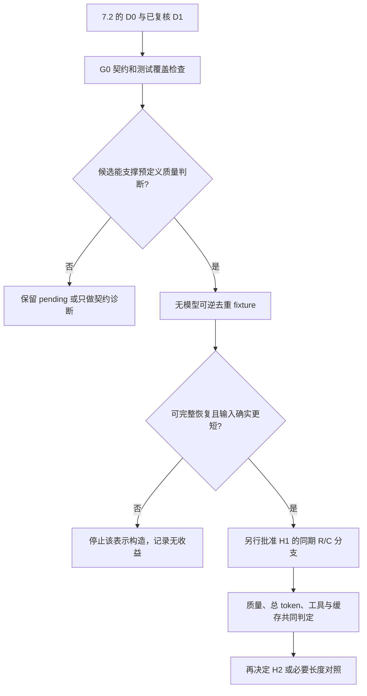

# 第 7.3 节：从 baseline 现象形成可证伪假设

日期：2026-10-03（香港时间）。依据第 7.2 节冻结结果（提交 `4747aff`）。状态：**7.3 分析已完成；所有 7.4 分支、阈值与预算均为待确认建议，未启动实验。** 本轮新增外部模型调用、agent rollout、候选代码执行、重评分、memory 写入均为 0。

## 1. 建议优先检验什么

优先主线是 **H1：在源信息和来源覆盖保持不变时，可逆去重的经验表示能否降低总 token，并维持当前任务质量**。先用简单、无 LLM writer 的结构表示建立对照；不要直接跳到新的多层 memory 架构。

H2 把“必要条件虽然存在，却没有在目标适配时得到检查”作为独立诊断，先限定到 559。H3 包装、H4 提取目标、H5 AWM 更新预算有明确可观察现象，但暂作解释/适配对照，不把五个方向同时开发。**选择 H1 是研究优先级判断，不是声称 7.2 已证明压缩有效或输入冗余是唯一根因。**

依据是：Jaccard 在这批任务中有最高正确数与较高对应源覆盖，适合作为强简单参照；成本高却没有有效目标工作工具总量下降，值得首先检验能否降低费用负担。相反，多数失败的契约疑点还没有排除，直接以“会使用经验”为主张容易混入评分问题。

| 现象 | 证据支持到哪里 | 7.3 的处理 |
| --- | --- | --- |
| Jaccard 27/46 对 18/46；全代码 token 3.91×；有效目标工作工具同为52 | D0描述，质量/成本权衡；9个改善含1个无记忆传输故障 | 优先研究保持质量的低成本表示，不把9个改善视为纯因果收益 |
| ICL 45/46 个源包装丢弃 | 源候选存在但不可见，非检索漏召回 | H3包装机制对照，已有Jaccard强简单参照，暂不作为主创新 |
| Mem0 91空facts+4原生JSON拒绝 | 写入稀疏/格式问题是事实，原因为D1 | H4适配诊断；不得把内容不存在归为retrieval failure |
| AWM索引47–95 workflow不变，49次字节预算拒绝 | 当前预算下未更新，不是已证遗忘 | H5预算/历史范围诊断，不能冒称该阶段持续online学习 |
| ACE全代码6.916M已知token，约50.7%为辅助角色 | 开销高、部分来源条目预算丢弃 | 保留强对照；不以复杂程度或helpful计数证明价值 |
| 16重点失败中15有契约疑点；559固定列名越界较具体 | D1候选；只有少量适配行为可直接定位 | G0先分契约与机制；H2只作559单例条件适配诊断 |

举例：同一段代码若先出现在 PYTHON 调用、又原样出现在 SUBMIT，候选去重表示只存一份代码，并让两个有序事件各自引用它；工具结果、错误和发生顺序仍保留。若两版代码不同，就保留两版，不能把“看起来类似”当成精确重复。还原结果相同只是构造检查，模型是否同样读得懂仍需实验。

原始多标签频数不参与“哪一机制最常见”的排序。7.2 中 46 段未匹配引用、源库/实际注入语义混用、BabyAI SUBMIT 误判已经表明，自动标签不是可靠的机制真值。这里优先引用 D0 和逐例复核后的具体事实。

## 2. G0：先确认成败能回答实验问题

G0 是进入干预的条件，不是 memory 创新，也不代表修改旧榜单。

1. 固定保留 7.1/7.2 原始分母、分数、费用与排除项。新的诊断资格表与评分版本独立存放，**不把旧46题悄悄改成另一个分母**。
2. 先核对测试真正调用提交函数。316 的同名覆盖不能作为成功质量证据；954 的无记忆工具故障不能当纯能力失败。这两项不进入拟议主批次。
3. 核对规范、输入、输出与断言是否对齐。存在歧义时保留 pending；必要的契约澄清必须来自公开题意/合法源经验，不能将隐藏参考答案灌进 solver。
4. 核对测试是否检查所声称的质量。若要补性质检查，在看新分支结果之前按规范定义、冻结且放在隔离评分端；原分数与新性质结果并列，不冒称原 benchmark 成绩。
5. 任务进入诊断与否由上述规则决定；已知的源通过/失败、目标历史成败只用于离线分层，不能流入 writer 筛选和检索规则。

### 2.1 本轮静态检查暴露的边界

- `815`：现有三条断言只验证结果非空，不能验证676个 bigram及逐词计数。源失败、未注入、目标通过只能作为**弱评分的警示例**，不作为“坏源没有损害”的因果证据。
- `896`：断言主要验证形状、列名和行数，没有检查单元格是否属于合法字母集。形状通过不够支撑完整质量保持。
- `739`：现有用例 threshold=4 且各组期待无 outlier，还需正离群点、零方差、组索引与方差定义的检查，不能仅靠当前一条复合断言。
- `699`：题面允许平局，测试却断言不得平局，且各次调用重新随机生成。先隔离随机断言风险，暂不作为质量保持样本。
- `619`：目标题未显式说明字节序；来源示例/可见探索可能提供合法约定，但必须核验这一条件，不能只借用隐藏参考的 `!f`。
- `559`：固定列名问题可单独定位，但 tuple是否排序另有语义未定；用“是否仍访问不适用列名”的具体行为指标诊断，不把整个任务pass当唯一机制证据。

这些是新增静态阅读记录，没有执行候选代码或修正原 scorer。[候选任务、实际断言及快照哈希](records/candidate-snapshots.json)

源经验正确性保留为所有假设的竞争解释和离线分层，不另开一条付费实验线：174 的源失败且已注入、269 的源不可评分且已注入，均不能归入“正确经验使用失败”；源通过也不证明每条陈述或所有边界正确。不能用隐藏通过标签筛选在线 writer/检索器。H1 首批限定来源配对通过的候选，同时保留其原选中集合中的所有合法失败/错误记录，不按 gold 清洗记忆。

## 3. 五个可证伪假设

### H1：经验表示中的可逆重复增加了成本，去重可能保留质量

**优先级：** recommended_first_after_G0。

| 7.3 必填项 | 分析 |
|---|---|
| 现象与证据等级 | D0：Jaccard 27/46 对 No Memory 18/46；有效目标 tokens 574109 对 162418，工作工具同为 52。完整代码 tokens 1214123 对 310663。对应源 44/46 实际注入。 D1：部分输入成本来自同一 episode 中重复的任务、代码或工具文本；保留原始信息与时序而改变重复内容的表示，有机会减少输入与总 token。 |
| 适用任务、历史起点与配置 | 候选 767、619、739、896，均使用各自 Jaccard memory-before 与原选中 episode 集；全部须先过 G0。Pi、GLM-5.3-Flash high、工具与目标环境、18 turns/8192 output/600s 等按既有配置提议重新冻结。主 solver 不是离线审查模型 DeepSeek。 |
| 主假设与竞争解释 | 主假设：精确重复文本去重后，总 token 减少且当次质量不下降。 竞争解释：冗余文本反而提供了有用的重复强调和易读性；模型解释引用需更多 reasoning 或工作工具；去重破坏缓存，非缓存输入成本/金额不降；现有分数过弱，表面保质只是 scorer 没检查；随机性和可变模型别名解释差异。 |
| 唯一改变因素 | 仅改变相同三条或原数量选中 episode 的序列化表示：R 为原文本，C 为可逆精确去重表示。冻结候选集合、ID、顺序与来源，不用省出的预算追加其他记忆，不加入目标解答提示。 |
| 预期改变与不变项 | 预期 C 的实际请求 memory bytes 与 provider 输入量下降；若总 token 与工具迭代没有反向增加，则总开销下降。任务契约、合法知识、来源覆盖、评分与质量约束应不变。缓存、输出、工具数可能变化，必须实际计入。 |
| 新增调用/预算与停止 | 建议只先做 4 题×2 条件×R=1，最多 8 个 solver task，0 个 writer LLM 调用。历史四题总 tokens 47839，双倍 95678 仅作量级参照，不是预算上限。任一 G0/哈希/隔离失败停止对应题；402、未知费用或新 scorer 冲突停止批次讨论；不自动补题/重试/重复。具体金额与 token 硬上限需另行确认。 |

**什么结果会反驳或不足以支持：**

- C 无法可逆恢复或丢条件：构造无效，尚未形成假设检验。
- 有效 C 更短却出现 R 通过/C 失败或性质检查退化：本批质量保持条件被反驳。
- 输入字节下降但全角色总 token 不降或增加：本批总-token 经济性不成立。
- 仅当前 scorer 通过而性质覆盖不足：证据不充分，不算支持。
- 极少数样本保质省 token：只支持当前条件的候选，不证明总体非劣或新算法优势。

**C 的构造约束：**

- 只利用原合法 episode 字节，重复内容保留一个 definition 并用有序 reference 表示；所有非重复任务条件、工具调用、观察、错误与可见说明保留。
- 先做无模型 fixture：expand(C) 与原合法 episode 的规范化结构逐字段一致，记录哈希和映射。可逆性不等于模型等效使用。
- 不能使用目标隐藏测试、参考解、gold source ID、源隐藏通过标签；不只保留正确源，不丢弃失败轨迹。
- 若引用/说明开销后 C 不更短，停止该构造；不自动改成有损摘要或追加 LLM writer。

**建议判断门槛（尚未获批冻结）：** 每题当次 Q_C>=Q_R 且满足预声明性质；合计全角色 totalTokens 建议下降至少 20%，在 G0 后冻结的 n<=4 题中至少 ceil(0.75*n) 题下降（四题时为3题）。工作工具、重复/无效操作和非缓存输入另列，若明显退化不得概括为全面效率提升；未获准不得把 20% 当已批准门槛。

**主张边界：** 这是创新前的简单结构去重基线；若收益仅来自序列化/编码变化，报告为工程经济性收益，不升格为新的记忆学习机制。条件抽象或有损摘要的额外价值需另行证明。
### H2：显式暴露源适用条件可能减少条件越界复用

**优先级：** separate_small_diagnostic_if_selected。

| 7.3 必填项 | 分析 |
|---|---|
| 现象与证据等级 | D0：Jaccard/559 的源通过、原 episode 完整注入，目标仍硬编码 item1–item5 并出现 KeyError。ACE 同题成功，但五种其他方法失败；不是控制变量比较。 D1：源条件虽在长 episode 中存在，却没有成为目标适配时被检查的显式条件。 |
| 适用任务、历史起点与配置 | 仅 new:BigCodeBench/559，使用 Jaccard 原冻结起点和同样注入；先把列名适配谓词与未明确的组合排序语义分开。 |
| 主假设与竞争解释 | 主假设：合法源条件的显式说明，比同长度的一般检查提醒更能避免直接复用固定列名。 竞争解释：一般提醒引发额外推理就足够；任何额外计算都有效，非条件内容作用；模型仍错误处理类型/排序，避免 KeyError 不等于全题正确；重跑随机性导致差异。 |
| 唯一改变因素 | 附加说明的语义内容。R 原样；G 一般核对提醒；S 根据源题原文提取的条件说明。G/S 放同位置，UTF-8 字节长度近似匹配并记录偏差；不能冒称精确 token 匹配。 |
| 预期改变与不变项 | S 应减少在没有这些列的合法目标输入上访问 item1–item5 的行为；G 未必同样改善。源知识、其余注入、模型、预算、目标及检查相同；总分、类型、排序与成本独立报告。 |
| 新增调用/预算与停止 | 另行决定后最多 1 题×3 条件=3 个 solver task、0 writer LLM；必须重跑当次 R，不能把旧 7.1 或 H1 结果充当同期对照。检查失败、条件泄漏或异常时停止，不自动加重复。 |

**什么结果会反驳或不足以支持：**

- S 与 G 行为无差异：不支持条件信息本身的特异效应
- S 仍直接使用固定列名：反驳本条件提示在此例有效的预测
- 仅避免 KeyError 而其他质量下降：不支持总体改进
- 只有一次三分支差异：不能推出稳定负迁移修复

**只依据源的说明示例：** 该源任务规定列为 item1、item2、item3、item4、item5；复用这段实现前核对当前任务是否仍满足该列约束。

**主张边界：** 源条件人工展示只是诊断条件；部署贡献必须由训练/测试隔离的自动源条件形成机制另证，不能使用目标 gold 生成提示。
### H3：固定预算下的包装优先级使可用源不可见

**优先级：** parked_engineering_control。

| 7.3 必填项 | 分析 |
|---|---|
| 现象与证据等级 | D0：ICL 46/46 对应源进入选择集，45/46 包装丢弃；ACE 源候选42/46、注入19/46，部分来源同时存在保留和丢弃条目。 D1：query-aware 包装在同字节预算下保留更适用的信息，可能减少再发现成本。 |
| 适用任务、历史起点与配置 | 从固定 ICL 自己的 before-state 选择预登记目标；不能用不同方法各自历史比较当隔离包装因素。 |
| 主假设与竞争解释 | 主假设：仅改变包装优先级即可改变信息可见性及效率。 竞争解释：被丢信息实际不必要或有误；保留当前最近经验更重要；Jaccard 这类简单方法已经充分解决，缺创新空间；覆盖提高但输入噪声/推理成本抵消。 |
| 唯一改变因素 | 同候选、同48000字节上限，仅 FIFO 与合法 query 词法优先级不同。不得用离线 gold source ID 优先保留；结果出来后才 join 来源标签。 |
| 预期改变与不变项 | 预期源/相关信息实际注入改变；模型、任务、总字节上限、history固定。质量与成本是待测结果，不由覆盖推导。 |
| 新增调用/预算与停止 | 暂不与H1并跑。未来最多先2题×2条件=4个solver task；来源选择必须合法、保持预算，未满足则零调用停止。 |

**什么结果会反驳或不足以支持：**

- 包装并未提高可用内容可见性
- 可见性提高但质量/工具效率不变或变差
- 用简单Jaccard即可达到同效果，则不支持更复杂机制的必要性

**主张边界：** 主要是解释当前基线瓶颈和提供强简单对照，不把 FIFO→相关性排序直接命名为研究创新。
### H4：Mem0 当前提取目标与程序经验不匹配

**优先级：** parked_adapter_diagnostic。

| 7.3 必填项 | 分析 |
|---|---|
| 现象与证据等级 | D0：96次代码写入有91次空facts、4次原生JSON拒绝，主要得到两条泛化描述；41个源通过且目标有效的配对均未注入对应源 provenance。 D1：提取器关注的事实类型不适配这里的可执行程序经验。 |
| 适用任务、历史起点与配置 | 冻结一个空facts源 episode与一个真实非空提取episode作为对照，先确定其ID；原prompt与源观察导向prompt使用完全相同合法文本。 |
| 主假设与竞争解释 | 主假设：改变提取目标能形成有条件、可核验的操作经验。 竞争解释：原历史确实无值得存的信息；消息角色或adapter接线问题；输出格式拒绝与语义空结果是不同问题；提取多了但错误/无用内容也更多。 |
| 唯一改变因素 | 仅提取prompt，模型、legal episode、存储/检索配置固定；新版本明确命名为适配变体，不改写原生 baseline 身份。 |
| 预期改变与不变项 | 有来源支持的具体操作/条件条目可能增加；事实条数不能替代正确性与下游效用。不得引入隐藏评分筛选。 |
| 新增调用/预算与停止 | 暂停候选：若另行批准，先2 episodes×2 prompts=4 writer调用，仅验证提取，不宣称reader收益；完整流改进必须新跑相应方法流。 |

**什么结果会反驳或不足以支持：**

- 仅多写泛话/无证据断言
- 错误率增加或必要条件仍缺失
- 非空结果不能改善任何预定义下游行为时，不支持任务效用主张

**主张边界：** 优先排查方法适配，不能由该次classic配置推出Mem0全系列无效。
### H5：AWM 累计历史预算导致更新停滞，受限历史可能恢复更新但未必保质

**优先级：** parked_budget_diagnostic。

| 7.3 必填项 | 分析 |
|---|---|
| 现象与证据等级 | D0：索引47–95的49次writer逻辑尝试被320000字节请求上限拒绝，workflow内容不变；writer已知token占全代码73.0%。 D1：以既有workflow加当前合法episode替代累计全历史可减少更新输入、恢复写入；信息保留与reader效用未知。 |
| 适用任务、历史起点与配置 | 从两个已归档长历史检查点复制同起点；原workflow、当前episode、模型/字节上限固定，分叉不回写主流。 |
| 主假设与竞争解释 | 主假设：限制writer历史范围能够通过请求预算并产生新可用更新。 竞争解释：增量模式丢了必要旧条件；现有workflow已经足够，更多更新无价值；输出成功但泛化质量差；重算/整理维护成本抵消输入节省。 |
| 唯一改变因素 | 仅writer输入的历史范围，保持旧workflow+当前episode；不得同时换模型、提高字节上限、改reader检索或扩大输出预算。 |
| 预期改变与不变项 | 是否进入HTTP、是否形成内容变化及所花tokens是直接可观测项；未来reader质量必须另测，状态hash变化本身不是学习质量。 |
| 新增调用/预算与停止 | 暂停候选：最多先2个检查点各1个新writer请求，原输入的预算拒绝可离线复核；若要reader效用需另批4个solver task。修改writer后的完整方法结论仍需从初始状态运行完整流。 |

**什么结果会反驳或不足以支持：**

- 仍超预算或没有合法更新
- 新workflow丢失已知必要条件
- 更新恢复却reader质量/总成本退化

**主张边界：** 请求预算下的可运行性/适配问题；不把增量摘要作为已证新算法或把本次冻结当真实遗忘。

## 4. 建议的最小 7.4 顺序

**只建议先选 H1 小批，不把所有假设的预算相加。** 目前候选四题 `767、619、739、896` 分别覆盖路径距离、字节转换、统计分析、表格生成；包含历史两例 Jaccard/No Memory 都通过和两例描述性改善，全部源通过且已注入。选择已使用开发结果，**不是盲抽样、未见测试或新的独立验证集**。

候选需要 G0 核验后才能冻结为执行清单。若某题不合格，先缩小批次并记录原因，不根据新分支分数挑替代题。本轮没有把任何候选标为已批准可跑。

| 候选目标 | 用途 | Jaccard源通过/注入/目标通过 | 测评前提 |
| --- | --- | --- | --- |
| 767 | H1_candidate | True / True / True | 检查裸数/单元素元组、回到起点、空/单点及数值容差；原测试有精确浮点相等，须先确认固定运行时。 |
| 619 | H1_candidate | True / True / True | 目标未写字节序；检查合法源示例与可见测试是否足以支撑 network/big-endian 约定，仅对该可核验解释作结论。 |
| 739 | H1_candidate | True / True / True | 原测试 threshold=4 且期望均无 outlier；先补查可检出离群点、零方差、组索引、方差定义的质量覆盖。 |
| 896 | H1_candidate | True / True / True | 原断言主要为 shape/columns/row count；先核验单元格确为合法字母、拼接内容与空输入，不用形状通过代替语义正确。 |
| 559 | H2_single_case_candidate | True / True / False | 只诊断固定列名被带入一般 DataFrame 的行为；排序/组合顺序语义另有歧义，不把全题 pass/fail 当唯一机制指标。 |
| 815 | G0_guardrail_only | False / False / True | 三条 assert 只检查非空；源失败且未注入、目标成功不能证明源没用/系统稳健。暂不进入质量保持主结论。 |
| 983 | G0_guardrail_only | True / True / True | 测试主要检查四个部门的输出长度，缺合法 level 与输入覆盖检查；不是默认 H1 主样本。 |
| 699 | G0_guardrail_only | True / True / True | 题面允许 tie game，测试断言不得 tie；随机断言风险需隔离，不作为默认质量保持证据。 |

### 4.1 保持同起点

- H1 的 R/C 均从同一任务的 **Jaccard 自己的 memory-before**、同一环境初态与原选中 episode 集开始，每分支新建隔离会话。
- 同期重跑 R，不能拿旧 No Memory 或旧 Jaccard 的一次结果当新 C 的唯一对照。各方法自己历史不同，7.2 的跨方法表也不能充当这个实验。
- 两分支都只读同一冻结历史；不得把前一分支或当前目标的答案、反馈、writer更新带到后一分支或另一目标。候选历史与注入的路径/SHA已登记。
- 建议预先交替 R/C 执行顺序，记录请求顺序、provider返回模型、cache分项与资源配置；不能强称模型随机性或服务端缓存已完全控制。
- 只运行同一冻结 Pi/GLM 配置，保留工具、响应/任务上限、源码和环境版本。DeepSeek 是 7.2 的**审查器**，不因此替换 GLM 主 solver。

### 4.2 计量和判定

对每个任务 i 定义 `Δtokens_i = tokens(C_i) - tokens(R_i)`，工作工具、重复/无效动作、错误后恢复步数、非缓存输入、输出与延迟分别报差，不合成一个混合“效率分”。API cacheRead 是 prompt 的子集，completion 已含 reasoning，不能重复加。具体memory块精确token若仍不可得，就报告可核验的实际请求字节与provider总usage，不估成真值。

完整经济性必须计 `构建 + 读取 + 更新/维护`。本次 H1 建议使用确定性可逆去重，writer LLM 调用为0，但解析/构建CPU耗时、保存量与缓存仍记录；跨多个目标复用的构建费用应计一次并披露摊销次数。实验执行费用包含 R/C 两臂，但部署成本比较不能把 R 的费用也算到 C 方法身上。

建议先采用“当次 C 不比同期 R 新增质量失败”这一保守筛查条件，并同时通过 G0 冻结的性质检查；**四题R=1零下降不等于统计上的非劣性证明**。20% token下降和至少 ceil(0.75*n) 题下降（n为G0后冻结题数，四题时为3题）只是尚未批准的实用门槛，后续执行前可由用户调整；不在看到新结果后改门槛。

只省输入字节但输出/工具开销抵消，不支持总-token经济性；只省totalTokens但非缓存输入或金额增大，不称货币成本更低；质量退化则不能称Pareto改善。无invoice或完整usage时金额/总量保持未知。

### 4.3 调用规模与停止规则

| 项目 | 建议范围及边界 |
|---|---|
| 本轮7.3实际新增 | 0外部模型调用、0 rollout、0重评分、0 memory修改 |
| H1首批 | 最多4题×R/C×1次 = **8个solver任务**；writer LLM=0 |
| 历史量级 | 同四题原Jaccard共 **47,839 tokens、9 turns**；双倍约 **95,678 tokens**只是参照，不能作为预测或硬上限 |
| 保留原单任务上限时的极端包络 | 8×18=144逻辑生成；如每次最多2个额外传输重试则最多432 HTTP attempts；按8192输出上限计算输出包络3,538,944 tokens。输入另计，320k字节guard不是token上限 |
| 硬预算 | 7.4的总token/金额上限和传输重试策略**尚未确认**；7.0/7.1的历史授权不自动延伸到新实验 |
| H2若后续另选 | 单题3分支=3个solver任务，必须包含新的同期R；不默认叠加到H1 |
| H3/H4/H5 | 暂存，不预付费、不自动扩展；各自小规模提议见注册表 |

G0未通过、C不可逆/不更短、源/输入哈希不符或隔离失败：在模型调用前停止对应构造。运行中出现402、usage缺项影响费用判定、新评分冲突或会突破已批准预算：在安全边界停下并讨论，不无限重试、补题或加独立重复。R/C任一异常都保留，不用重跑后的好结果替换。

若之后修改writer/retriever并声称完整方法更好，必须从相同初始状态重新跑相应完整流；这组只读分叉不能代替它。最终验证/SkillFlow/项目场景仍保留，当前不读取其正式实例来调整假设。

## 5. 如何由结果决定后续方向

| 观察到的结果 | 可以作出的决定 | 不可以作出的结论 |
|---|---|---|
| 可逆表示明显更短，但C质量下降 | 检查引用表示可读性/重复强调价值，拒绝当前保质构造 | 必须改用更大模型或任意扩大预算 |
| C保质且总token下降达到预定门槛 | 保留简单去重为强基线，再讨论额外有损压缩/条件抽象是否有增益 | 当前四题足以证明长期或未见泛化 |
| C字节更短、totalTokens/工具不降 | 当前经济性假设未获支持，保留负结果 | 用输入字节下降包装成总体效率提升 |
| 条件说明S与一般提醒G效果相同 | 不支持“条件内容”特异机制，可能是提醒/额外计算 | 条件模块已证明有效 |
| 包装提高来源可见性但下游不变 | 把覆盖与效用分开，优先简单对照 | 只凭coverage宣布记忆改善 |
| 新提取/新更新只让条目更多 | 只确认写入/可运行性，再评质量与读取效用 | 状态变化就是持续学习质量提升 |
| G0无法形成足够可靠的质量对照 | 先完成基准/契约诊断，必要时收缩本轮主张 | 用未见验证集来补开发失败或静默更换benchmark |

不为完成项目提前命名最终方法。若收益仅来自序列化去重，报告为工程经济性基线，不升格为记忆学习创新；条件抽象或有损压缩是否有额外价值仍需另证。清楚解释基线失效条件的负结果也需要对应证据。

## 6. 产物与完成核对

- [假设注册表](records/hypotheses.json)：G0及H1–H5，逐项覆盖现象、适用起点、竞争解释、唯一改动、预测、反驳、预算/停止。
- [证据汇总](records/evidence-summary.json)、[候选快照](records/candidate-snapshots.json)、[建议预算](records/proposed-budget.json)、[输入哈希](records/source-hashes.json)。
- [完成核对](records/section7.3-completion-audit.json)：只读来源核验及无新调用边界。
- `build_evidence.py` 只解析已有JSON和测试AST；`write_report.py` 从注册表生成本文，不调用模型。

本节完成的是**从现象形成可证伪假设**。尚未完成的不是被省略的7.3实验，而是需另行确定的7.4执行：候选G0验收、确切干预文本/表示、quality/费用硬门槛、分支顺序与停止预算。人类逐条签认、因果证据、重复稳定性与外部验证均未被本分析替代。
