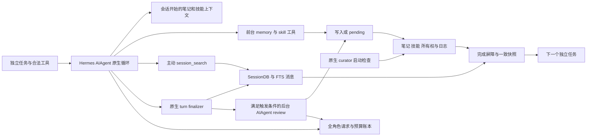

# S0 接入审查与路线决定

2026-10-03，香港时间。完成计划 7.4.1–7.4.2；范围为源码、历史资产与无模型接口 spike。**选择路线 B：Hermes 原生 Harness，复用现有 benchmark、沙箱及观测规范。** 此决定是工程选型，不是性能排名，也不表示 S0 已通过 7.4.3 验收。

Pi 加 Hermes 的笔记、搜索、技能工具可以接通；本轮已验证这些 Python 接口可独立使用。但保留完整系统还涉及会话保存、原生提示快照、维护触发、后台 AIAgent fork、压缩、审批、技能所有权及成本归属。若主循环留在 Pi，就需要维护两套生命周期之间的桥接。因此路线 A 不满足计划中的“薄适配”条件。

工程量估计：仅工具演示约 **1–2 人日**，但不构成 S0；完整 A 约 **12–21 人日**，B 约 **6–11 人日**。这是按工作包作出的工程估算，置信度低至中，**不是本轮实测工时、报价或工期承诺**。范围和拆分见下文。

## 审查范围与版本

| 对象 | 实际核对 | 边界 |
| --- | --- | --- |
| 新 Hermes | 官方 `c8301ea6c9b797184df16a9c5dd462400b264ff4`，2026-10-03；MIT | 本轮只读克隆，工作树未改；这是所选 revision，不是“已验证稳定版” |
| 历史 Hermes | `07ab19b0a399f33bd760852e0b0588d07efe8c22` | 旧工作树未改；45 个有界审查文件中 14 个字节不同，不能把旧运行等同于新版本 |
| 当前实验 Pi | `@earendil-works/pi-agent-core` / `pi-ai` **1.0.0**，MIT；锁文件保留 integrity | 分析的是实际使用的 agent-core，不是整个 Pi coding-agent CLI。未升级 Pi |
| Python | Hermes `.python-version=3.14`；本机复用环境实测 **3.14.7** | `pyproject` 的 `>=3.11,<3.15` 是兼容更新入口范围，源码注释明确运行支持 3.14；不能据此说 3.12 完整支持 |
| Python 依赖 | 实测 OpenAI 2.24.0、Anthropic 0.87.0、httpx 0.28.1、pydantic 2.13.4、ruamel.yaml 0.18.16、psutil 7.2.2 | `uv.lock` 与直接依赖哈希已记录；本轮未安装依赖，也未证明整个旧环境与新 lock 完全一致 |
| Node | 现有 22.20.0 满足 Pi `>=22.19.0`；Hermes 全产品声明 `^22.22.0 \|\| ^24.11.0 \|\| >=26.0.0` | Python 接口 spike 不需要 Node；若安装 Hermes TUI/浏览器等 Node 组件，须单独准备兼容 runtime，不能直接宣称现有 Node 满足它 |

源码清单、函数行号、逐文件 SHA256、历史差异与包版本见 [source-audit.json](records/source-audit.json)。正式入口为 `run_agent.AIAgent`，使用显式 `SessionDB` 和工具注册；本轮验证了导入及参数签名，尚未构造完整任务 agent 或调用 `run_conversation`。不需要为本阶段部署 CLI、gateway、聊天渠道或服务。

## 原生闭环的实际边界



图中主循环、工具语义、review、curator、存储来自 Hermes；任务适配、访问约束、完成屏障和完整研究账本是本项目必须补的工程。**B 也不是把 `AIAgent` 调一下就完成。**

| 能力 | 固定版本的实际行为 | 路线 A 要承担的工作 |
| --- | --- | --- |
| 常驻笔记 | `MemoryStore` 在载入时冻结 system-prompt 快照；中途写磁盘不改变该快照，下一会话重新载入。MEMORY / USER 默认上限 2200 / 1375 字符 | 管理每个 Pi 任务对应的 store、快照寿命与原生提示，不把每次写入都重注入当前 system |
| 历史搜索 | FTS discovery、指定会话 read、围绕消息 scroll、无参数 browse；返回原始 DB 消息与截断信息，**该 revision 不调用 LLM 摘要** | 转换并保存 Pi 消息、工具关联、session lineage，保留主动多轮搜索及返回范围 |
| Skills | 渐进暴露、按需 `skill_view`、`skill_manage` 创建/修改、读后写保护、所有权、ledger 与备份；技能正文由 agent 使用，执行仍依靠已授权工具 | 保留工具调用身份、读记录、write-origin 上下文和元数据；不是复制 SKILL.md 文件即可 |
| 前台维护 | Agent 可直接调用 memory/skill 工具；是否写入由策略决定 | 工具 RPC 本身很小，但必须保留 store 注入、权限和操作反馈 |
| 后台 review | 默认 memory 间隔 **10 个用户 turn**；skill 间隔 **10 个工具循环 iteration**。finalizer 满足条件且未关闭 review 才启动原生 fork；review 上限 16 iteration | 对齐两种计数器、触发时机、fork 的系统提示与 tools、父子身份、取消及完成状态 |
| 上下文压缩 | 原生 context compressor、会话轮转、辅助模型和持久化相互关联；后台 fork 的压缩必须脱离父 DB | 移植或桥接压缩及 session 边界；仅用 Pi `transformContext` 丢历史会改变原生机制 |
| Curator | 独立于逐轮 review。默认启用、周期间隔 7 天、至少空闲 2 小时；确定性老化/归档，LLM consolidation 默认关闭 | 还需挂接启动时机。B 的程序化 wrapper 同样须调用原生 `maybe_run_curator`，不能漏掉 CLI startup 才有的入口 |

依据：[笔记](https://github.com/NousResearch/hermes-agent/blob/c8301ea6c9b797184df16a9c5dd462400b264ff4/tools/memory_tool_store.py#L88)、[搜索](https://github.com/NousResearch/hermes-agent/blob/c8301ea6c9b797184df16a9c5dd462400b264ff4/tools/session_search_tool.py#L619)、[触发计数](https://github.com/NousResearch/hermes-agent/blob/c8301ea6c9b797184df16a9c5dd462400b264ff4/agent/turn_context.py#L745)、[finalizer](https://github.com/NousResearch/hermes-agent/blob/c8301ea6c9b797184df16a9c5dd462400b264ff4/agent/turn_finalizer.py#L737)、[后台 fork](https://github.com/NousResearch/hermes-agent/blob/c8301ea6c9b797184df16a9c5dd462400b264ff4/agent/background_review.py#L985)、[默认配置](https://github.com/NousResearch/hermes-agent/blob/c8301ea6c9b797184df16a9c5dd462400b264ff4/hermes_cli/config_defaults.py#L1497)。在线文档和 README 仍可能写“search with summarization”，本报告采用固定源码行为。

**短任务的触发问题必须预先登记。** 本项目每个独立任务开启新前台会话；原生函数 fixture 表明，同一会话第十次 tick 才触发，而十二个新会话各 tick 一次均不触发。它不证明真实 agent 不会前台写笔记，也不代表 skills review 永不触发。S0 初始设计保留原生间隔 10，不偷改为每题强制 review，也不延续前台对话来凑轮次。7.4.3 用单独能力 fixture 验证触发，性能流如实记录 NOOP。

## 状态与权限不能只靠一个目录名

| 状态 | 需要保留 | 一致性与只读方案 |
| --- | --- | --- |
| 笔记 | `memories/MEMORY.md`、`USER.md` 及版本/哈希 | 会话提示快照和磁盘当前值分开；只读分支拒绝修改工具 |
| 历史 | `state.db` 中 session/message、FTS、lineage、辅助 usage 等 | 等待写者结束后 SQLite backup 或可靠关闭后复制；不能仅复制活动 WAL 下的主文件 |
| 技能 | `skills/` 全树，包括所有权、使用记录、隐藏元数据、archive、ledger；根目录 `.curator_backups/blobs/` 等回滚依赖 | 按 profile 实际文件 inventory 快照，保留引用的 blob；只读还要限制读取产生的 usage/ledger 写入 |
| 审批 | `pending/memory/`、`pending/skills/` | pending 与 committed 分开统计，不能视为学习已经生效 |
| 队列 | review run token、线程、idle queue 和子任务 | idle queue 是进程内 best-effort 状态，不是可复制的持久队列；快照前 drain，超时标未完成，禁止带着活线程提交下一任务 |
| 配置 | revision、实际 profile、工具表、skill 初态、模型路由、权限、时钟策略 | 7.4.3 冻结哈希；新用户/方法/环境不共享可写 home，恢复不能静默重新发现外部 skills |

原生 `SessionDB(read_only=True)` 的拒写已验证；**整个 Hermes profile 的只读尚未验收**。单纯关闭 `memory` 不会自动冻结 skills、pending、会话记录或 curator。只读诊断应将来源快照不可写、当前执行日志放在临时状态中，并拒绝所有知识状态写回；对 S0 正常在线流仍保留原生维护。

`session_search(profile=...)` 能显式打开其他 profile；它不是多租户安全边界。`read_file/search_files` 也不能直接获得宿主仓库权限。计划采用每条流独立进程与 home、只挂载合法资源、在主/后台共用 dispatch 层限制 profile 与文件路径（包括嵌入 profile 的 session 链接），并核查 symlink、外部 skills、自动发现和辅助角色。隐藏 tests、gold、未来任务及研究日志不进入任何可搜索库。

技能 `inline_shell` 原生默认关闭，保留此值；模板变量可保留。初始 skill 白名单为空，另提供 S0/N/J 共用的中性工具协议说明；不导入用户已有技能或上游任务解题库。保留学习技能的原生机制与后台 fork，关闭与当前 benchmark 无关的通用 terminal/web/MCP/消息渠道/自由 delegation 是共同工具范围约束，不把后台维护也关掉。

**待审批是实际运行约束。** 即使 `memory.write_approval=false`，无人值守 background review 的 `replace/remove` 仍会被原生代码转为 pending；本轮已验证替换未写入。前台修改和后台新增另按原生策略执行。初始设计保留该规则，绝不自动批准或将 staged 标为 committed。后续若需要全自动破坏性维护，应登记成共同配置变更或候选机制，不能作为“接线修复”偷偷放开。[原生 gate](https://github.com/NousResearch/hermes-agent/blob/c8301ea6c9b797184df16a9c5dd462400b264ff4/tools/memory_tool.py#L166)

## 成本与观测的增量工作

搜索自身无模型调用，仍有检索延迟和返回内容导致的下次输入成本；前台工具调用属于 solver 轨迹。后台 review 会运行原生 AIAgent；压缩、标题等其他辅助入口也可能调用模型。Curator 默认确定性整理不产生 LLM consolidation 费用；显式开启后的调用另计。本轮没有观测实际 GLM 请求，不能给出新系统 token 或金额排名。

Hermes 已有父 session 的 review usage 归账，以及 `pre/post_api_request`、辅助调用 hooks。它们适合做角色与生命周期映射，但 **不等于完整 HTTP 原始记录**：hook 默认总 payload 约 50,000 字符，字符串 8,000、序列 200 和嵌套深度等都会截断。必须另在实际 transport 层记录去凭据原始请求/响应、attempt、call/parent/role、usage 未返回状态；不能把截断 hook 当完整内容证据。[hooks](https://github.com/NousResearch/hermes-agent/blob/c8301ea6c9b797184df16a9c5dd462400b264ff4/agent/api_request_hooks.py#L51)

预算需要同时约束 solver、review、compression/title 等所有角色、失败与重试，并阻止辅助入口绕过。后台计数与 provider 原始 usage 两层对账，避免主任务加子任务时重复计数；usage 缺失保持 unknown。任务完成顺序应为：停止接收新任务动作 → 原生 finalizer → 合法维护结束或明确超时 → 状态快照及费用提交。`SUBMIT`/`ACTION` 结束不能简单杀进程，否则可能丢失维护；这仍需 7.4.3 fixture。

## 原有资产如何复用

| 资产 | 可以复用 | 必须调整 |
| --- | --- | --- |
| `run_hermes_task.py` | 原生 AIAgent 入口、registry 注册、进程独立 profile 的方法 | 旧代码 `skip_background_review=True`，无 skills，USER 关闭；通常只有导入历史时显式传 DB；只复制 `memories/*.md`。不得整体作为完整 S0 |
| `native_archive_files.py` | 使用 canonical `read_file/search_files` 名称包裹原生 handler、记录日志和路径限制 | 合法 root 扩为受控 workspace/技能/归档，主后台统一，新增 symlink/跨 profile 验收 |
| `api_proxy.py` | 固定 upstream、去凭据、请求上限、HTTP/SSE 记录思路 | Anthropic 专用且会改 thinking/max_tokens，不是中性代理；缺全角色关联及完整新预算，不能直接照搬 |
| `engine.py`、`broker.py` | CodeTask/BabyTask、任务顺序/seed、PYTHON/SUBMIT/ACTION、WSL 评分与隔离、提交证据 | 抽离任务层，替换 Pi 启动和即时 `selected` 注入；保留原生 prompt、finalizer 和维护，旧文件冻结不改 |
| `recorder_v2.mjs` | 数据规范、ID、hash、usage unknown、请求和提交证据契约 | JS fetch 拦截不能直接记录 Python SDK；Python transport adapter 新实现，原有 payload 映射扩为笔记/搜索/skill/辅助角色 |
| Jaccard 与旧报告 | 选择/包装逻辑、可用历史来源、诊断线索 | N/J 重新在 Hermes 同底座登记；旧 Pi 分数仅历史附录，不能作为新 S0 同期对照 |

上述 12 个本仓库源码/配置的 SHA256 已登记并可核验，旧实验源码、轨迹、评分 mask 均未修改。

## 两条路线的成本判断

Pi 本身已有 `transformContext`、`prepareRequest`、工具前后 hook、`finishTurn`、事件订阅与等待 idle，**不是 Pi 做不到这些能力**。问题是 Hermes 的后台实现直接创建 `AIAgent`，复用父 `_memory_store`、cached prompt、session identity、tools 和 provider 状态，同时将自身持久化与父 DB 分离。若在 Pi 外挂一个 Hermes sidecar 保留它，实际是两种 agent runtime 的状态桥，而不是独立 memory SDK。[Pi 当前接口证据](records/source-audit.json)、[后台构造源码](https://github.com/NousResearch/hermes-agent/blob/c8301ea6c9b797184df16a9c5dd462400b264ff4/agent/background_review.py#L941)

下表是假设一名熟悉现有实验底座的开发者，做到可运行开发 S0、隔离/恢复/日志 fixture 和有限 canary 接线的工程估计。**不含 S1、完整基准运行、最终场景、重新修全部评分器，也不含付费等待与审批等待。** 不用未经实现的 LOC 或“复用百分比”制造精确感。

| 工作包 | A Pi 与 Hermes | B Hermes 原生 |
| --- | ---: | ---: |
| 版本、运行时与 profile | 1–2 人日 | 0.5–1 人日 |
| 任务工具、终止与沙箱映射 | 1–2 | 1–2 |
| 会话、prompt 与 memory/skills 生命周期 | 3–5 | 0.5–1 |
| 后台 review、curator 启动与完成屏障 | 3–5 | 1–2 |
| 全角色日志、transport 与预算 | 1.5–3 | 1–2 |
| 快照恢复、只读、N/J 回归验收 | 2.5–4 | 2–3 |
| **合计** | **12–21 人日** | **6–11 人日** |

A 的主要额外成本在接通之后：上游改一处 session、压缩或后台 prompt，就需要检查 Node/Python 两端的对应关系。B 主要保留一套 native loop，研究改动落在可关闭的 memory 钩子上。两者都必须付出权限、观测和状态工程，不能把这些当 B 的独有缺点。

估计最大的未知是 GLM 全角色路由与原始 transport 覆盖，以及独立任务终止/后台结束的边界。本轮入口导入与工具复用通过，只降低了“装不起来/接口不可用”的不确定性，未验证这两个集成问题。若 B 在一次有界 7.4.3 接入后仍无法满足权限、状态或账本，停止并报告具体缺口，不自动退回 A 重造系统，也不扩展多产品竞赛。

## 本轮验证与下一步

本轮无模型 spike 六组通过：笔记冻结快照与次会话加载；搜索 discovery/read/scroll/无命中及 SQLite backup 恢复/只读拒写；skill create/view/patch 和路径拒绝；skill pending 与原生后台 memory 替换 pending；review 计数边界；AIAgent 导入及参数。

这是实际固定源码的组件调用，其中计数使用合成 parent，skill approval 分支通过 mock 配置开关，memory 后台 gate 使用真实配置与原生 origin context。无真实模型回答、无性能任务、无后台模型执行；skills 的 `preprocess=False`，没有验证脚本执行或整个 profile 只读。[结果与限制](records/interface-spike.json)

首次 fixture 的过严子进程 guard 阻断了 Windows `platform` 版本探测及可选 git 探测，导致部分导入失败；保留 [attempt1](records/interface-spike-attempt1.json)。修正 fixture 为先读取标准库平台信息、guard 用可正常处理的 `OSError` 拒绝后续子进程；上游源码未修补，后续六组通过。网络/DNS 和子进程在上游导入前被 guard 禁止；记录的七次子进程尝试均被拒绝。后续增补后台破坏性写入 gate 检查后仍六组通过。不能将这个 fixture 设置问题称为 Hermes 运行缺陷。

**7.4.1、7.4.2 完成；7.4.3、S0 冻结和 S1 未执行。** [路线及拟用 profile](records/base-system-decision.json) 登记唯一主要 Harness、初态、权限、维护及 N/J 定义；profile 哈希仍为 null，表示尚未运行冻结。[有限 canary 草案](records/canary-proposal.json) 保留 4 个已访问代码任务及 8 个 BabyAI，R=1；S0 12 次，确需匹配 N/J 时总上限 36。给出全角色调用上限草案，token/金额与实际 transport 行为待 7.4.3 确定，草案禁止直接执行。

下一阶段优先实现 **Hermes 任务适配、原始 transport/角色账本、状态与后台完成屏障** 三个工程包，然后做权限与长历史等完整 fixture，最后才以单次 batch 确认启动有限在线 canary。本报告不申请额外实验，也不将当前任务扩为 7.4.3。

## 复核方法

```powershell
# 有缓存的固定源码时，重建源码清单；不导入 agent 或调用模型
python -X utf8 experiments/section7_s0_audit_20261003/audit_sources.py

# 本轮使用的 Hermes Python 3.14 环境，显式传解释器路径；无模型接口探针
& <Hermes-Python-3.14路径> -X utf8 experiments/section7_s0_audit_20261003/interface_spike.py --source experiments/section7_s0_audit_20261003/.cache/hermes-source

# 无需 Hermes 缓存或依赖的交付核验
python -X utf8 experiments/section7_s0_audit_20261003/verify.py
```

缓存源码可从官方仓库取上述完整 commit；Git TLS 在本机 Schannel 报错后以单命令 `-c http.sslBackend=openssl` 读取成功，没有关闭证书验证或修改全局 Git 配置。源码缓存、合成 profile 和运行时不提交。固定源码哈希清单、探针结果及脚本进入仓库；新机器需重新取得对应源码和兼容依赖才能复跑接口。
